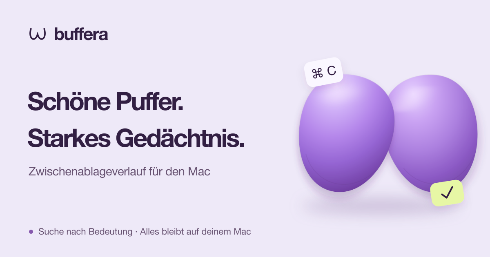

<p align="center">
  <a href="README.md">English</a> | <a href="README.ru.md">Русский</a> | <a href="README.es.md">Español</a> | <a href="README.de.md"><strong>Deutsch</strong></a> | <a href="README.fr.md">Français</a> | <a href="README.pt-BR.md">Português (Brasil)</a> | <a href="README.zh-Hans.md">简体中文</a> | <a href="README.ja.md">日本語</a>
</p>

<p align="center">
  <a href="https://buffera.app/de/">
    
  </a>
</p>

<p align="center">
  <strong>Texte, Links, Bilder und Dateien — auch nach dem nächsten ⌘C noch griffbereit.</strong><br>
  macOS 14+ · Apple Silicon · Englisch, Russisch, Spanisch, Deutsch, Französisch, Portugiesisch (Brasilien), vereinfachtes Chinesisch und Japanisch
</p>

<p align="center">
  <a href="https://github.com/dqunbp/buffera/releases/latest/download/Buffera-macOS-arm64.dmg"><strong>Für Mac herunterladen ↓</strong></a>
  &nbsp; · &nbsp;
  <a href="https://buffera.app/de/">Website und Demo</a>
  &nbsp; · &nbsp;
  <a href="https://buffera.app/de/docs/">Benutzerhandbuch</a>
  &nbsp; · &nbsp;
  <a href="https://github.com/dqunbp/buffera/releases">Neuigkeiten</a>
</p>

## Kopieren. Finden. Wiederverwenden.

Buffera speichert den Verlauf deiner Zwischenablage auf deinem Mac. Drücke <kbd>⌘⌥V</kbd>, suche einen Eintrag und drücke <kbd>Enter</kbd> — schon liegt er wieder in der Zwischenablage, bereit zum Einfügen mit <kbd>⌘V</kbd>. Du kannst Einträge auch direkt in andere Apps ziehen.

| Funktion | Das kannst du damit machen |
| :--- | :--- |
| **Verlauf durchsuchen** | Texte, Links oder Dateien finden und nach App und Datum filtern. |
| **Text in Bildern** | Bildschirmfotos anhand der enthaltenen Wörter finden. Die Texterkennung läuft auf deinem Gerät. |
| **Semantische Suche und Chat** | „Welchen Fehler habe ich gestern kopiert?“ fragen und den Eintrag zur Antwort öffnen. |
| **Anders kopieren** | Formatierung entfernen, JSON aufräumen oder Text in eine `.txt`- / `.md`-Datei umwandeln. |
| **Favoriten und benachbarte Einträge** | Wichtiges griffbereit halten oder sehen, was du davor und danach kopiert hast. |
| **MCP für Agenten** | Deinen Verlauf mit Claude Code, Codex und anderen MCP-Clients verbinden. |

Helles, dunkles und systemabhängiges Design. Listen- und Rasteransicht. Anpassbare Tastenkürzel und ein Verlaufsfenster, das du über anderen Apps anheften kannst.

## In einer Minute startklar

1. [Lade die DMG-Datei herunter](https://github.com/dqunbp/buffera/releases/latest/download/Buffera-macOS-arm64.dmg) und ziehe Buffera in **Programme**.
2. Öffne die App und durchlaufe die kurze Einrichtung. Optionale Schritte kannst du überspringen.
3. Kopiere etwas und drücke <kbd>⌘⌥V</kbd>.

> Buffera 1.0.0 ist mit Developer ID signiert und von Apple notarisiert. Bestätige beim ersten Start das Öffnen der heruntergeladenen App, falls macOS danach fragt. [Details zur Installation →](docs/INSTALL.txt)

Semantische Suche und Chat sind optional: Aktiviere sie in den Einstellungen, um die lokalen Modelle herunterzuladen. Der Verlauf funktioniert auch ohne sie. [Suche und Modelle einrichten →](https://buffera.app/de/docs/search/)

## Dein Verlauf bleibt auf deinem Mac

Verlauf, Texterkennung und integrierte Modelle arbeiten lokal. Der Zugriff über MCP ist standardmäßig deaktiviert. Sobald du einen externen Agenten verbindest, bestimmt dieser, wie die von ihm gelesenen Daten verarbeitet werden.

Von der Quell-App als geheim markierte Inhalte werden standardmäßig übersprungen. Du kannst die verschlüsselte Speicherung aktivieren; verborgene Inhalte bleiben von Suche, Chat und MCP ausgeschlossen. Ein Passwort ohne diese Markierung kann als gewöhnlicher Text gespeichert werden. [So funktioniert der Datenschutz →](https://buffera.app/de/docs/privacy/)

## Mehr entdecken

[Tastenkürzel und Tipps](https://buffera.app/de/docs/shortcuts/) · [Agenten verbinden](https://buffera.app/de/docs/agents/) · [Buffera fragen](https://buffera.app/de/docs/assistant/) · [Versionen](https://github.com/dqunbp/buffera/releases)

<details>
<summary><strong>Aus dem Quellcode bauen</strong> — Swift + AppKit</summary>

Du brauchst die Command Line Tools mit **Swift 6.4+**. Die vollständige Xcode-Installation ist optional. Führe im Stammverzeichnis des Repositorys Folgendes aus:

```sh
zsh scripts/build-app.sh
open dist/Buffera.app
```

Die technische Dokumentation ist auf Englisch und Russisch verfügbar; siehe [Verzeichnis](docs/README.md). Die folgenden Links führen zur englischen Fassung:

[Build-Anleitung](docs/en/guide.md#build-and-run) · [Prüfungen](docs/en/guide.md#checks) · [Architektur](docs/en/architecture.md) · [Lokalisierung](docs/en/localization.md) · [Release-Ablauf](docs/en/releases.md)

</details>

---

Gefällt dir Buffera? [Entwicklung unterstützen ↗](https://web.tribute.tg/d/SHI)
