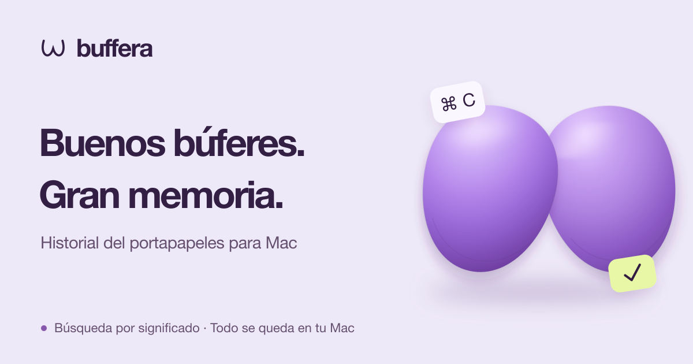

<p align="center">
  <a href="README.md">English</a> | <a href="README.ru.md">Русский</a> | <a href="README.es.md"><strong>Español</strong></a> | <a href="README.de.md">Deutsch</a> | <a href="README.fr.md">Français</a> | <a href="README.pt-BR.md">Português (Brasil)</a> | <a href="README.zh-Hans.md">简体中文</a> | <a href="README.ja.md">日本語</a>
</p>

<p align="center">
  <a href="https://buffera.app/es/">
    
  </a>
</p>

<p align="center">
  <strong>Texto, enlaces, imágenes y archivos: a mano incluso después del siguiente ⌘C.</strong><br>
  macOS 14+ · Apple Silicon · Inglés, ruso, español, alemán, francés, portugués (Brasil), chino simplificado y japonés
</p>

<p align="center">
  <a href="https://github.com/dqunbp/buffera/releases/latest/download/Buffera-macOS-arm64.dmg"><strong>Descargar para Mac ↓</strong></a>
  &nbsp; · &nbsp;
  <a href="https://buffera.app/es/">Web y demostración</a>
  &nbsp; · &nbsp;
  <a href="https://buffera.app/es/docs/">Guía de uso</a>
  &nbsp; · &nbsp;
  <a href="https://github.com/dqunbp/buffera/releases">Novedades</a>
</p>

## Copia. Encuentra. Reutiliza.

Buffera guarda el historial del portapapeles en tu Mac. Pulsa <kbd>⌘⌥V</kbd>, busca una entrada y pulsa <kbd>Enter</kbd>: vuelve al portapapeles, lista para pegarla con <kbd>⌘V</kbd>. También puedes arrastrar las entradas directamente a otras aplicaciones.

| Función | Qué puedes hacer |
| :--- | :--- |
| **Búsqueda en el historial** | Encuentra texto, enlaces o archivos. Filtra por aplicación y fecha. |
| **Texto en imágenes** | Encuentra una captura por las palabras que contiene, con reconocimiento de texto en el dispositivo. |
| **Búsqueda semántica y chat** | Pregunta «¿Qué error copié ayer?» y abre la entrada en la que se basa la respuesta. |
| **Copiar de otra forma** | Quita el formato, ordena JSON o convierte texto en un archivo `.txt` / `.md`. |
| **Favoritos y entradas cercanas** | Ten lo importante a mano o consulta lo que copiaste antes y después. |
| **MCP para agentes** | Conecta tu historial a Claude Code, Codex y otros clientes MCP. |

Temas claro, oscuro y del sistema. Vistas de lista y cuadrícula. Atajos personalizables y una ventana de historial que puedes fijar por encima de otras aplicaciones.

## Empieza en un minuto

1. [Descarga el DMG](https://github.com/dqunbp/buffera/releases/latest/download/Buffera-macOS-arm64.dmg) y arrastra Buffera a **Aplicaciones**.
2. Abre la aplicación y completa la breve configuración; puedes omitir los pasos opcionales.
3. Copia algo y pulsa <kbd>⌘⌥V</kbd>.

> Buffera 1.0.0 está firmada con Developer ID y notarizada por Apple. En el primer inicio, confirma que quieres abrir la aplicación descargada si macOS lo solicita. [Detalles de instalación →](docs/INSTALL.txt)

La búsqueda semántica y el chat son opcionales: actívalos en Ajustes para descargar los modelos locales. El historial funciona sin ellos. [Configurar la búsqueda y los modelos →](https://buffera.app/es/docs/search/)

## Tu historial se queda en tu Mac

El historial, el reconocimiento de texto y los modelos integrados funcionan localmente. El acceso por MCP está desactivado por defecto; al conectar un agente externo, ese agente determina cómo se procesan los datos que lee.

Los secretos marcados por la aplicación de origen no se guardan por defecto. Puedes activar su almacenamiento cifrado; el contenido oculto queda excluido de la búsqueda, el chat y MCP. Una contraseña sin esa marca puede guardarse como texto normal. [Cómo funciona la privacidad →](https://buffera.app/es/docs/privacy/)

## Más información

[Atajos y consejos](https://buffera.app/es/docs/shortcuts/) · [Conectar un agente](https://buffera.app/es/docs/agents/) · [Preguntar a Buffera](https://buffera.app/es/docs/assistant/) · [Versiones](https://github.com/dqunbp/buffera/releases)

<details>
<summary><strong>Compilar desde el código fuente</strong> — Swift + AppKit</summary>

Necesitas Command Line Tools con **Swift 6.4+**. La instalación completa de Xcode es opcional. Ejecuta desde la raíz del repositorio:

```sh
zsh scripts/build-app.sh
open dist/Buffera.app
```

La documentación técnica está disponible en inglés y ruso; consulta el [índice](docs/README.md). Los enlaces siguientes llevan a la versión en inglés:

[Detalles de compilación](docs/en/guide.md#build-and-run) · [Comprobaciones](docs/en/guide.md#checks) · [Arquitectura](docs/en/architecture.md) · [Localización](docs/en/localization.md) · [Publicación de versiones](docs/en/releases.md)

</details>

---

¿Te gusta Buffera? [Apoya su desarrollo ↗](https://web.tribute.tg/d/SHI)
