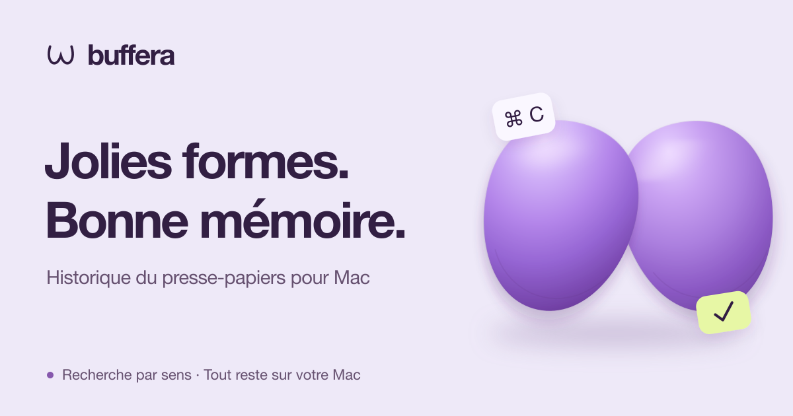

<p align="center">
  <a href="README.md">English</a> | <a href="README.ru.md">Русский</a> | <a href="README.es.md">Español</a> | <a href="README.de.md">Deutsch</a> | <a href="README.fr.md"><strong>Français</strong></a> | <a href="README.pt-BR.md">Português (Brasil)</a> | <a href="README.zh-Hans.md">简体中文</a> | <a href="README.ja.md">日本語</a>
</p>

<p align="center">
  <a href="https://buffera.app/fr/">
    
  </a>
</p>

<p align="center">
  <strong>Textes, liens, images et fichiers : toujours à portée de main après le prochain ⌘C.</strong><br>
  macOS 14+ · Apple Silicon · Anglais, russe, espagnol, allemand, français, portugais (Brésil), chinois simplifié et japonais
</p>

<p align="center">
  <a href="https://github.com/dqunbp/buffera/releases/latest/download/Buffera-macOS-arm64.dmg"><strong>Télécharger pour Mac ↓</strong></a>
  &nbsp; · &nbsp;
  <a href="https://buffera.app/fr/">Site et démo</a>
  &nbsp; · &nbsp;
  <a href="https://buffera.app/fr/docs/">Guide d’utilisation</a>
  &nbsp; · &nbsp;
  <a href="https://github.com/dqunbp/buffera/releases">Nouveautés</a>
</p>

## Copiez. Retrouvez. Réutilisez.

Buffera conserve l’historique de votre presse-papiers sur votre Mac. Appuyez sur <kbd>⌘⌥V</kbd>, trouvez un élément et appuyez sur <kbd>Entrée</kbd> : il revient dans le presse-papiers, prêt à être collé avec <kbd>⌘V</kbd>. Vous pouvez aussi faire glisser les éléments directement dans d’autres apps.

| Fonction | Ce qu’elle permet |
| :--- | :--- |
| **Recherche dans l’historique** | Retrouver du texte, des liens ou des fichiers. Filtrer par app et par date. |
| **Texte dans les images** | Retrouver une capture grâce aux mots qu’elle contient, avec la reconnaissance de texte sur l’appareil. |
| **Recherche sémantique et chat** | Demander « Quelle erreur ai-je copiée hier ? » et ouvrir l’élément à l’origine de la réponse. |
| **Copier autrement** | Retirer la mise en forme, remettre du JSON en ordre ou transformer du texte en fichier `.txt` / `.md`. |
| **Favoris et éléments voisins** | Garder l’essentiel à portée de main ou voir ce qui a été copié avant et après. |
| **MCP pour les agents** | Connecter votre historique à Claude Code, Codex et d’autres clients MCP. |

Thèmes clair, sombre et système. Vues en liste et en grille. Raccourcis personnalisables et fenêtre d’historique que vous pouvez épingler au-dessus des autres apps.

## Commencez en une minute

1. [Téléchargez le DMG](https://github.com/dqunbp/buffera/releases/latest/download/Buffera-macOS-arm64.dmg) et faites glisser Buffera dans **Applications**.
2. Ouvrez l’app et suivez la courte configuration. Les étapes facultatives peuvent être ignorées.
3. Copiez quelque chose et appuyez sur <kbd>⌘⌥V</kbd>.

> Buffera 1.0.0 est signée avec Developer ID et notariée par Apple. Au premier lancement, confirmez l’ouverture de l’app téléchargée si macOS le demande. [Détails d’installation →](docs/INSTALL.txt)

La recherche sémantique et le chat sont facultatifs : activez-les dans Réglages pour télécharger les modèles locaux. L’historique fonctionne sans eux. [Configurer la recherche et les modèles →](https://buffera.app/fr/docs/search/)

## Votre historique reste sur votre Mac

L’historique, la reconnaissance de texte et les modèles intégrés fonctionnent localement. L’accès par MCP est désactivé par défaut ; une fois un agent externe connecté, c’est lui qui détermine le traitement des données qu’il lit.

Les secrets signalés par l’app source ne sont pas enregistrés par défaut. Vous pouvez activer leur stockage chiffré ; les contenus masqués sont exclus de la recherche, du chat et de MCP. Un mot de passe sans ce signalement peut être enregistré comme du texte ordinaire. [Comprendre la confidentialité →](https://buffera.app/fr/docs/privacy/)

## Pour aller plus loin

[Raccourcis et conseils](https://buffera.app/fr/docs/shortcuts/) · [Connecter un agent](https://buffera.app/fr/docs/agents/) · [Demander à Buffera](https://buffera.app/fr/docs/assistant/) · [Versions](https://github.com/dqunbp/buffera/releases)

<details>
<summary><strong>Compiler depuis les sources</strong> — Swift + AppKit</summary>

Les Command Line Tools avec **Swift 6.4+** sont nécessaires. L’installation complète de Xcode est facultative. Depuis la racine du dépôt, exécutez :

```sh
zsh scripts/build-app.sh
open dist/Buffera.app
```

La documentation technique est disponible en anglais et en russe ; consultez l’[index](docs/README.md). Les liens ci-dessous mènent à la version anglaise :

[Détails de compilation](docs/en/guide.md#build-and-run) · [Vérifications](docs/en/guide.md#checks) · [Architecture](docs/en/architecture.md) · [Localisation](docs/en/localization.md) · [Publication des versions](docs/en/releases.md)

</details>

---

Buffera vous plaît ? [Soutenir le développement ↗](https://web.tribute.tg/d/SHI)
