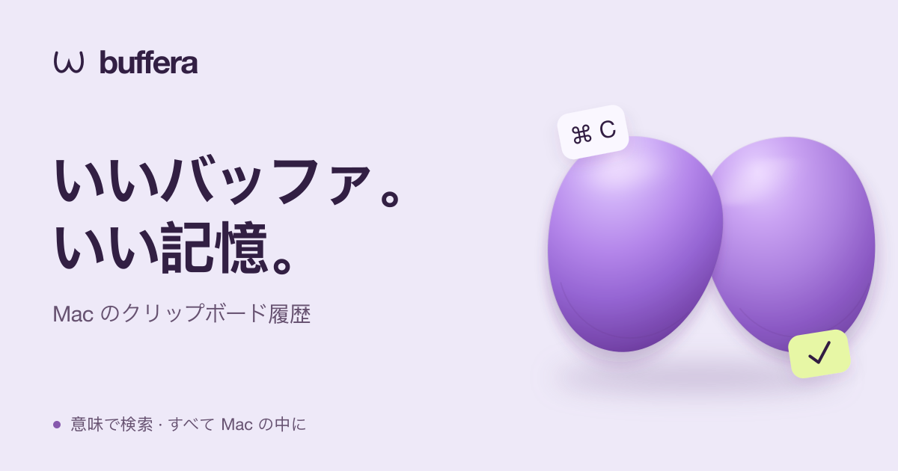

<p align="center">
  <a href="README.md">English</a> | <a href="README.ru.md">Русский</a> | <a href="README.es.md">Español</a> | <a href="README.de.md">Deutsch</a> | <a href="README.fr.md">Français</a> | <a href="README.pt-BR.md">Português (Brasil)</a> | <a href="README.zh-Hans.md">简体中文</a> | <a href="README.ja.md"><strong>日本語</strong></a>
</p>

<p align="center">
  <a href="https://buffera.app/ja/">
    
  </a>
</p>

<p align="center">
  <strong>テキスト、リンク、画像、ファイル。次の ⌘C の後も、すぐ手元に。</strong><br>
  macOS 14+ · Apple Silicon · 英語、ロシア語、スペイン語、ドイツ語、フランス語、ポルトガル語（ブラジル）、簡体字中国語、日本語
</p>

<p align="center">
  <a href="https://github.com/dqunbp/buffera/releases/latest/download/Buffera-macOS-arm64.dmg"><strong>Mac 版をダウンロード ↓</strong></a>
  &nbsp; · &nbsp;
  <a href="https://buffera.app/ja/">ウェブサイトとデモ</a>
  &nbsp; · &nbsp;
  <a href="https://buffera.app/ja/docs/">使い方ガイド</a>
  &nbsp; · &nbsp;
  <a href="https://github.com/dqunbp/buffera/releases">更新情報</a>
</p>

## コピー。検索。もう一度使う。

Buffera はクリップボードの履歴を Mac に保存します。<kbd>⌘⌥V</kbd> を押し、必要な項目を見つけて <kbd>Enter</kbd> を押すと、クリップボードに戻り、<kbd>⌘V</kbd> で貼り付けられます。項目をほかのアプリに直接ドラッグすることもできます。

| 機能 | できること |
| :--- | :--- |
| **履歴の検索** | テキスト、リンク、ファイルを検索し、アプリや日付で絞り込めます。 |
| **画像内のテキスト** | スクリーンショットに含まれる文字で画像を探せます。文字認識はデバイス上で行われます。 |
| **意味による検索とチャット** | 「昨日コピーしたエラーは？」と質問し、回答の根拠となる項目を開けます。 |
| **別の形式でコピー** | 書式を除去したり、JSON を整形したり、テキストを `.txt` / `.md` ファイルに変換したりできます。 |
| **お気に入りと前後の項目** | 大切なものを手元に残したり、その前後にコピーした内容を確認したりできます。 |
| **エージェント向け MCP** | 履歴を Claude Code、Codex などの MCP クライアントに接続できます。 |

ライト、ダーク、システム連動のテーマ。リストとグリッドの表示。変更できるショートカットと、ほかのアプリの上に固定できる履歴ウィンドウ。

## 1 分で使い始める

1. [DMG をダウンロード](https://github.com/dqunbp/buffera/releases/latest/download/Buffera-macOS-arm64.dmg)し、Buffera を**アプリケーション**フォルダにドラッグします。
2. アプリを開いて短い初期設定を進めます。任意の手順はスキップできます。
3. 何かをコピーし、<kbd>⌘⌥V</kbd> を押します。

> Buffera 1.0.0 は Developer ID で署名され、Apple の公証を受けています。初回起動時に macOS が確認を求めた場合は、ダウンロードしたアプリを開くことを許可してください。[インストールの詳細 →](docs/INSTALL.txt)

意味による検索とチャットは任意の機能です。設定で有効にすると、ローカルモデルがダウンロードされます。これらを使わなくてもクリップボード履歴は利用できます。[検索とモデルの設定 →](https://buffera.app/ja/docs/search/)

## 履歴はあなたの Mac に

履歴の保存、文字認識、内蔵モデルの処理はローカルで行われます。MCP 経由のアクセスは初期状態では無効です。外部エージェントを接続した場合、読み取ったデータの扱いはそのエージェントによって決まります。

コピー元のアプリが機密とマークした内容は、初期状態では保存されません。暗号化して保存する設定も可能です。非表示の内容は検索、チャット、MCP の対象外です。マークのないパスワードは、通常のテキストとして保存される場合があります。[プライバシーの仕組み →](https://buffera.app/ja/docs/privacy/)

## もっと詳しく

[ショートカットとヒント](https://buffera.app/ja/docs/shortcuts/) · [エージェントを接続](https://buffera.app/ja/docs/agents/) · [Buffera に質問](https://buffera.app/ja/docs/assistant/) · [リリース](https://github.com/dqunbp/buffera/releases)

<details>
<summary><strong>ソースからビルド</strong> — Swift + AppKit</summary>

**Swift 6.4+** を含む Command Line Tools が必要です。完全版の Xcode は任意です。リポジトリのルートで実行してください。

```sh
zsh scripts/build-app.sh
open dist/Buffera.app
```

技術文書は英語とロシア語で提供しています。[索引](docs/README.md)から参照できます。以下のリンク先は英語版です。

[ビルドの詳細](docs/en/guide.md#build-and-run) · [チェック](docs/en/guide.md#checks) · [アーキテクチャ](docs/en/architecture.md) · [ローカライズ](docs/en/localization.md) · [リリース手順](docs/en/releases.md)

</details>

---

Buffera を気に入っていただけましたか？[開発を支援する ↗](https://web.tribute.tg/d/SHI)
