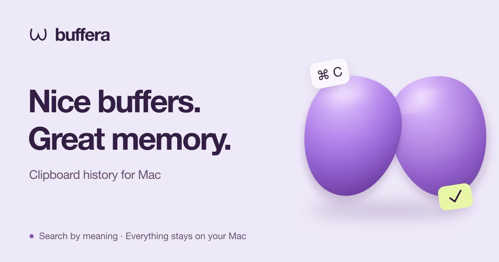

<p align="center">
  <a href="README.md"><strong>English</strong></a> | <a href="README.ru.md">Русский</a>
</p>

<p align="center">
  <a href="https://buffera.app/en/">
    
  </a>
</p>

<p align="center">
  <strong>Text, links, images and files — still within reach after your next ⌘C.</strong><br>
  macOS 14+ · Apple Silicon · English &amp; Russian
</p>

<p align="center">
  <a href="https://github.com/dqunbp/buffera/releases/latest/download/Buffera-macOS-arm64.dmg"><strong>Download for Mac ↓</strong></a>
  &nbsp; · &nbsp;
  <a href="https://buffera.app/en/">Website &amp; demo</a>
  &nbsp; · &nbsp;
  <a href="https://buffera.app/en/docs/">User guide</a>
  &nbsp; · &nbsp;
  <a href="https://github.com/dqunbp/buffera/releases">What's new</a>
</p>

## Copy. Find. Reuse.

Buffera keeps your clipboard history on your Mac. Press <kbd>⌘⌥V</kbd>, find a clip and hit <kbd>Enter</kbd> — it's back on your clipboard, ready to paste with <kbd>⌘V</kbd>. You can also drag clips straight into other apps.

| Feature | What you can do |
| :--- | :--- |
| **History search** | Find text, links or files. Narrow results by app and date. |
| **Text in images** | Find a screenshot by the words inside it, with on-device text recognition. |
| **Semantic search & chat** | Ask “What error did I copy yesterday?” and open the clip behind the answer. |
| **Copy differently** | Strip formatting, tidy up JSON or turn text into a `.txt` / `.md` file. |
| **Favorites & nearby clips** | Keep something handy or see what you copied before and after it. |
| **MCP for agents** | Connect your history to Claude Code, Codex and other MCP clients. |

Light, dark and system themes. List and grid layouts. Custom shortcuts and a history window you can pin above other apps.

## Get started in a minute

1. [Download the DMG](https://github.com/dqunbp/buffera/releases/latest/download/Buffera-macOS-arm64.dmg) and drag Buffera into **Applications**.
2. Open the app and go through the short setup — optional steps can be skipped.
3. Copy something and press <kbd>⌘⌥V</kbd>.

> Buffera 1.0.0 is signed with Developer ID and notarized by Apple. On first launch, confirm opening the downloaded app if macOS asks. [Installation details →](docs/INSTALL.txt)

Semantic search and chat are optional: enable them in Settings to download the local models. Clipboard history works without them. [Search and model setup →](https://buffera.app/en/docs/search/)

## Your history stays on your Mac

History, text recognition and the built-in models run locally. Access through MCP is off by default; once you connect an external agent, that agent determines how the data it reads is processed.

Secrets marked by the source app are skipped by default. You can enable encrypted storage for them; concealed content is excluded from search, chat and MCP. A password without that marker may be saved as ordinary text. [How privacy works →](https://buffera.app/en/docs/privacy/)

## Explore more

[Shortcuts and tips](https://buffera.app/en/docs/shortcuts/) · [Connect an agent](https://buffera.app/en/docs/agents/) · [Ask Buffera](https://buffera.app/en/docs/assistant/) · [Releases](https://github.com/dqunbp/buffera/releases)

<details>
<summary><strong>Build from source</strong> — Swift + AppKit</summary>

Requires Command Line Tools with **Swift 6.4+**. Full Xcode is optional. Run from the repository root:

```sh
zsh scripts/build-app.sh
open dist/Buffera.app
```

Technical documentation is currently in Russian:

[Build details](docs/guide.md#сборка-и-запуск) · [Checks](docs/guide.md#проверка) · [Architecture](docs/architecture.md) · [Localization](docs/localization.md) · [Release workflow](docs/releases.md)

</details>

---

Enjoying Buffera? [Support development ↗](https://web.tribute.tg/d/SHI)
