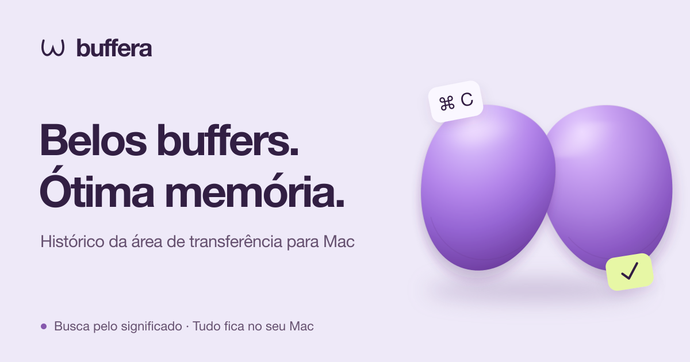

<p align="center">
  <a href="README.md">English</a> | <a href="README.ru.md">Русский</a> | <a href="README.es.md">Español</a> | <a href="README.de.md">Deutsch</a> | <a href="README.fr.md">Français</a> | <a href="README.pt-BR.md"><strong>Português (Brasil)</strong></a> | <a href="README.zh-Hans.md">简体中文</a> | <a href="README.ja.md">日本語</a>
</p>

<p align="center">
  <a href="https://buffera.app/pt-BR/">
    
  </a>
</p>

<p align="center">
  <strong>Textos, links, imagens e arquivos: à mão mesmo depois do próximo ⌘C.</strong><br>
  macOS 14+ · Apple Silicon · Inglês, russo, espanhol, alemão, francês, português (Brasil), chinês simplificado e japonês
</p>

<p align="center">
  <a href="https://github.com/dqunbp/buffera/releases/latest/download/Buffera-macOS-arm64.dmg"><strong>Baixar para Mac ↓</strong></a>
  &nbsp; · &nbsp;
  <a href="https://buffera.app/pt-BR/">Site e demonstração</a>
  &nbsp; · &nbsp;
  <a href="https://buffera.app/pt-BR/docs/">Guia de uso</a>
  &nbsp; · &nbsp;
  <a href="https://github.com/dqunbp/buffera/releases">Novidades</a>
</p>

## Copie. Encontre. Reutilize.

O Buffera mantém o histórico da área de transferência no seu Mac. Pressione <kbd>⌘⌥V</kbd>, encontre um item e pressione <kbd>Enter</kbd>: ele volta à área de transferência, pronto para colar com <kbd>⌘V</kbd>. Você também pode arrastar os itens diretamente para outros apps.

| Recurso | O que você pode fazer |
| :--- | :--- |
| **Busca no histórico** | Encontre textos, links ou arquivos. Filtre por app e data. |
| **Texto em imagens** | Encontre uma captura de tela pelas palavras que ela contém, com reconhecimento de texto no dispositivo. |
| **Busca semântica e chat** | Pergunte “Que erro eu copiei ontem?” e abra o item usado na resposta. |
| **Copiar de outro jeito** | Remova a formatação, organize JSON ou transforme texto em um arquivo `.txt` / `.md`. |
| **Favoritos e itens próximos** | Mantenha o que importa à mão ou veja o que copiou antes e depois. |
| **MCP para agentes** | Conecte seu histórico ao Claude Code, ao Codex e a outros clientes MCP. |

Temas claro, escuro e do sistema. Visualização em lista ou grade. Atalhos personalizáveis e uma janela de histórico que você pode fixar acima dos outros apps.

## Comece em um minuto

1. [Baixe o DMG](https://github.com/dqunbp/buffera/releases/latest/download/Buffera-macOS-arm64.dmg) e arraste o Buffera para **Aplicativos**.
2. Abra o app e siga a configuração rápida. Você pode pular as etapas opcionais.
3. Copie algo e pressione <kbd>⌘⌥V</kbd>.

> O Buffera 1.0.0 é assinado com Developer ID e notarizado pela Apple. Na primeira abertura, confirme a execução do app baixado se o macOS solicitar. [Detalhes da instalação →](docs/INSTALL.txt)

A busca semântica e o chat são opcionais: ative-os nos Ajustes para baixar os modelos locais. O histórico funciona sem eles. [Configurar a busca e os modelos →](https://buffera.app/pt-BR/docs/search/)

## Seu histórico fica no seu Mac

O histórico, o reconhecimento de texto e os modelos integrados funcionam localmente. O acesso por MCP vem desativado; ao conectar um agente externo, ele determina como os dados lidos são processados.

Segredos marcados pelo app de origem não são salvos por padrão. Você pode ativar o armazenamento criptografado; o conteúdo oculto fica fora da busca, do chat e do MCP. Uma senha sem essa marcação pode ser salva como texto comum. [Como funciona a privacidade →](https://buffera.app/pt-BR/docs/privacy/)

## Saiba mais

[Atalhos e dicas](https://buffera.app/pt-BR/docs/shortcuts/) · [Conectar um agente](https://buffera.app/pt-BR/docs/agents/) · [Perguntar ao Buffera](https://buffera.app/pt-BR/docs/assistant/) · [Versões](https://github.com/dqunbp/buffera/releases)

<details>
<summary><strong>Compilar a partir do código-fonte</strong> — Swift + AppKit</summary>

É necessário ter as Command Line Tools com **Swift 6.4+**. A instalação completa do Xcode é opcional. Na raiz do repositório, execute:

```sh
zsh scripts/build-app.sh
open dist/Buffera.app
```

A documentação técnica está disponível em inglês e russo; consulte o [índice](docs/README.md). Os links abaixo levam à versão em inglês:

[Detalhes de compilação](docs/en/guide.md#build-and-run) · [Verificações](docs/en/guide.md#checks) · [Arquitetura](docs/en/architecture.md) · [Localização](docs/en/localization.md) · [Publicação de versões](docs/en/releases.md)

</details>

---

Gostou do Buffera? [Apoie o desenvolvimento ↗](https://web.tribute.tg/d/SHI)
