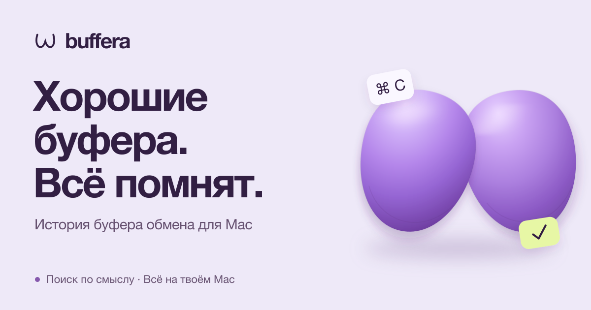

<p align="center">
  <a href="README.md">English</a> | <a href="README.ru.md"><strong>Русский</strong></a>
</p>

<p align="center">
  <a href="https://buffera.app/ru/">
    
  </a>
</p>

<p align="center">
  <strong>Текст, ссылки, картинки и файлы — под рукой, даже после следующего ⌘C.</strong><br>
  macOS 14+ · Apple Silicon · Русский и английский
</p>

<p align="center">
  <a href="https://github.com/dqunbp/buffera/releases/latest/download/Buffera-macOS-arm64.dmg"><strong>Скачать для Mac ↓</strong></a>
  &nbsp; · &nbsp;
  <a href="https://buffera.app/ru/">Сайт и демо</a>
  &nbsp; · &nbsp;
  <a href="docs/guide.md">Руководство</a>
  &nbsp; · &nbsp;
  <a href="https://github.com/dqunbp/buffera/releases">Что нового</a>
</p>

## Скопировал. Нашёл. Вернул.

Buffera сохраняет историю буфера обмена на твоём Mac. Открой её через <kbd>⌘⌥V</kbd>, найди нужную запись и нажми <kbd>Enter</kbd> — она снова в буфере, готова к вставке через <kbd>⌘V</kbd>. Карточки можно и просто перетаскивать в другие приложения.

| Возможность | Для чего |
| :--- | :--- |
| **Поиск по истории** | Найти текст, ссылку или файл; отфильтровать по приложению и дате. |
| **Текст на картинках** | Найти скриншот по словам внутри него — распознавание работает на Mac. |
| **Поиск по смыслу и чат** | Спросить «какую ошибку я копировал вчера?» и вернуться к записи из ответа. |
| **Скопировать иначе** | Убрать форматирование, привести JSON в порядок или превратить текст в `.txt` / `.md`. |
| **Избранное и соседние записи** | Сохранить важное или посмотреть, что копировал до и после. |
| **MCP для агентов** | Подключить историю к Claude Code, Codex и другим MCP-клиентам. |

Светлая, тёмная и системная темы. Список или сетка карточек. Настраиваемые клавиши и закрепление окна поверх других приложений.

## Начать за минуту

1. [Скачай DMG](https://github.com/dqunbp/buffera/releases/latest/download/Buffera-macOS-arm64.dmg) и перетащи Buffera в **Программы**.
2. Открой приложение и пройди короткую настройку — необязательные шаги можно пропустить.
3. Скопируй что-нибудь и нажми <kbd>⌘⌥V</kbd>.

> Сборка пока без нотарификации Apple. Если macOS блокирует запуск, после первой попытки открой **Системные настройки → Конфиденциальность и безопасность** и разреши запуск Buffera. [Подробная инструкция →](docs/INSTALL.txt)

Поиск по смыслу и чат включаются отдельно в настройках и скачивают локальные модели. Обычная история работает без них. [О моделях и расходе заряда →](docs/models.md)

## Твоя история — на твоём Mac

История, распознавание текста и встроенные модели работают локально. Доступ внешних агентов через MCP выключен по умолчанию; после подключения обработка прочитанного зависит от выбранного агента.

Помеченные приложением-источником секреты по умолчанию не сохраняются. Можно включить их зашифрованное хранение; содержимое скрытых записей недоступно поиску, чату и MCP. Пароль без такой отметки может сохраниться как обычный текст. [Как устроено хранение →](docs/guide.md#данные-и-ограничения)

## Дальше

[Все клавиши и приёмы](docs/guide.md#управление) · [Подключить агента](docs/mcp.md) · [Поиск и ответы](docs/models.md) · [Релизы](docs/releases.md)

<details>
<summary><strong>Собрать из исходников</strong> — Swift + AppKit</summary>

Нужны Command Line Tools со **Swift 6.4+**. Полный Xcode не обязателен. Из корня репозитория:

```sh
zsh scripts/build-app.sh
open dist/Buffera.app
```

[Подробности сборки](docs/guide.md#сборка-и-запуск) · [Проверки](docs/guide.md#проверка) · [Архитектура](docs/architecture.md) · [Локализация](docs/localization.md) · [Выпуск новой версии](docs/releases.md)

</details>

---

Нравится Buffera? [Поддержать разработку ↗](https://web.tribute.tg/d/SHI)
