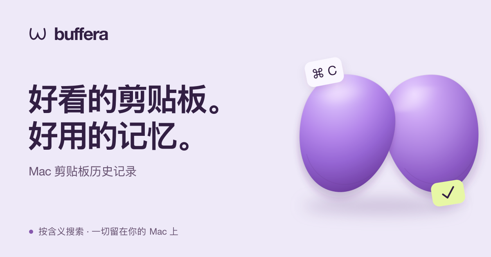

<p align="center">
  <a href="README.md">English</a> | <a href="README.ru.md">Русский</a> | <a href="README.es.md">Español</a> | <a href="README.de.md">Deutsch</a> | <a href="README.fr.md">Français</a> | <a href="README.pt-BR.md">Português (Brasil)</a> | <a href="README.zh-Hans.md"><strong>简体中文</strong></a> | <a href="README.ja.md">日本語</a>
</p>

<p align="center">
  <a href="https://buffera.app/zh-Hans/">
    
  </a>
</p>

<p align="center">
  <strong>文字、链接、图片和文件，再按一次 ⌘C，也依然找得到。</strong><br>
  macOS 14+ · Apple Silicon · 英语、俄语、西班牙语、德语、法语、葡萄牙语（巴西）、简体中文和日语
</p>

<p align="center">
  <a href="https://github.com/dqunbp/buffera/releases/latest/download/Buffera-macOS-arm64.dmg"><strong>下载 Mac 版 ↓</strong></a>
  &nbsp; · &nbsp;
  <a href="https://buffera.app/zh-Hans/">网站与演示</a>
  &nbsp; · &nbsp;
  <a href="https://buffera.app/zh-Hans/docs/">使用指南</a>
  &nbsp; · &nbsp;
  <a href="https://github.com/dqunbp/buffera/releases">更新内容</a>
</p>

## 复制。查找。再次使用。

Buffera 将剪贴板历史保存在你的 Mac 上。按下 <kbd>⌘⌥V</kbd>，找到一条记录，再按 <kbd>Enter</kbd>，内容就会回到剪贴板，随时可以用 <kbd>⌘V</kbd> 粘贴。你也可以将记录直接拖到其他应用中。

| 功能 | 用途 |
| :--- | :--- |
| **搜索历史** | 查找文字、链接或文件，按应用和日期缩小范围。 |
| **图片中的文字** | 通过截图中的文字找到图片，文字识别在设备上完成。 |
| **语义搜索与聊天** | 提问“我昨天复制了什么报错？”，并打开答案引用的记录。 |
| **换种方式复制** | 去除格式、整理 JSON，或将文字转换为 `.txt` / `.md` 文件。 |
| **收藏与相邻记录** | 将重要内容留在手边，或查看某条记录前后复制的内容。 |
| **供智能体使用的 MCP** | 将历史连接到 Claude Code、Codex 和其他 MCP 客户端。 |

支持浅色、深色和跟随系统的主题，列表与网格布局，自定义快捷键，以及可置顶于其他应用之上的历史窗口。

## 一分钟开始使用

1. [下载 DMG](https://github.com/dqunbp/buffera/releases/latest/download/Buffera-macOS-arm64.dmg)，将 Buffera 拖入**应用程序**文件夹。
2. 打开应用，完成简短设置；可选步骤可以跳过。
3. 复制一些内容，然后按下 <kbd>⌘⌥V</kbd>。

> Buffera 1.0.0 已使用 Developer ID 签名，并通过 Apple 公证。首次启动时，如果 macOS 询问，请确认打开下载的应用。[安装详情 →](docs/INSTALL.txt)

语义搜索和聊天是可选功能：在设置中启用后即可下载本地模型。不启用也能正常使用剪贴板历史。[设置搜索与模型 →](https://buffera.app/zh-Hans/docs/search/)

## 历史记录留在你的 Mac 上

历史存储、文字识别和内置模型都在本地运行。MCP 访问默认关闭；连接外部智能体后，它读取的数据如何处理，取决于该智能体。

来源应用标记为机密的内容默认不保存。你可以启用加密存储；隐藏的内容不会进入搜索、聊天或 MCP。未带有此标记的密码可能会作为普通文字保存。[了解隐私机制 →](https://buffera.app/zh-Hans/docs/privacy/)

## 了解更多

[快捷键与技巧](https://buffera.app/zh-Hans/docs/shortcuts/) · [连接智能体](https://buffera.app/zh-Hans/docs/agents/) · [询问 Buffera](https://buffera.app/zh-Hans/docs/assistant/) · [版本发布](https://github.com/dqunbp/buffera/releases)

<details>
<summary><strong>从源码构建</strong> — Swift + AppKit</summary>

需要包含 **Swift 6.4+** 的 Command Line Tools，无需安装完整的 Xcode。在仓库根目录运行：

```sh
zsh scripts/build-app.sh
open dist/Buffera.app
```

技术文档提供英语和俄语版本，详见[索引](docs/README.md)。以下链接指向英语文档：

[构建详情](docs/en/guide.md#build-and-run) · [检查](docs/en/guide.md#checks) · [架构](docs/en/architecture.md) · [本地化](docs/en/localization.md) · [版本发布流程](docs/en/releases.md)

</details>

---

喜欢 Buffera？[支持开发 ↗](https://web.tribute.tg/d/SHI)
