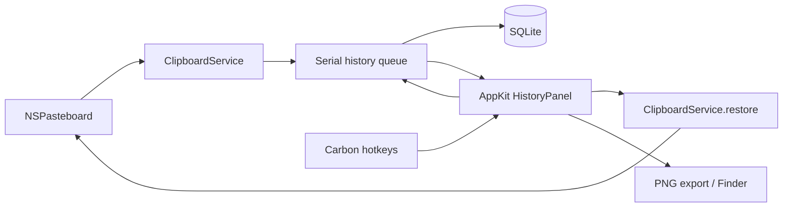

# Границы первой версии

`BuferaCore` содержит сериализуемый контракт содержимого и SQLite. `HistoryStore` используется только на одной последовательной очереди; все SQL-параметры связаны через prepared statements. Отдельная таблица payloads не загружается при поиске. Транзакция включает вставку, дедупликацию и применение лимитов. Уникальный хеш учитывает границы элементов, типы и бинарные данные. Идентификаторы не переиспользуются, в том числе для имён экспорта.

`ClipboardService` работает с AppKit на главном потоке. Данные копируются из NSPasteboardItem до передачи на очередь хранения. После чтения сверяется changeCount; устаревший снимок отбрасывается. Восстановление создаёт новые NSPasteboardItem и обновляет lastChange, чтобы избежать петли захвата.

`HotKeys` владеет регистрациями и обработчиком на `GetEventDispatcherTarget()`. V глобальна, C регистрируется только при открытом окне. Проверяются signature и id события. Регистрация V идемпотентна; после конфликта её можно повторить из меню, также она повторяется при завершении другого приложения. Отпускание клавиш не обрабатывается: таймера автоматического подтверждения нет.

`HistoryPanel` управляет выбором в окне, которое остаётся открытым после вызова. Только Enter или двойной щелчок подтверждают выбор; подтверждение до завершения первой загрузки откладывается до её результата. Escape и потеря фокуса отменяют выбор. При работе NSSavePanel потеря ключевого окна не отменяет сессию. `AppDelegate` связывает компоненты и отбрасывает результаты старых поисковых запросов по номеру поколения.

Панель имеет `.nonactivatingPanel` и `hidesOnDeactivate=false`: глобальный вызов может сделать её ключевой без предварительной активации фонового приложения. Решение «переместить выбор или открыть панель» проверяет и видимость, и ключевой статус окна. Системный Logger с subsystem `local.bufera.app` записывает только регистрацию клавиш и жизненный цикл панели, без содержимого буфера.

## Проверенные внешние контракты

| Граница | Источник | Защита |
| --- | --- | --- |
| Элементы буфера становятся недействительными после смены владельца | [NSPasteboardItem](https://developer.apple.com/documentation/appkit/nspasteboarditem) | Копирование Data, проверка changeCount |
| Нельзя повторно записывать объект, уже привязанный к буферу | Там же | Новые объекты при restore |
| Чтение может вернуть nil | [pasteboardItems](https://developer.apple.com/documentation/appkit/nspasteboard/pasteboarditems), data(forType:) | Пустой буфер пропускается; недоступный формат сообщает ошибку |
| Регистрация сочетания может конфликтовать | CarbonEvents.h из установленного SDK, RegisterEventHotKey | Проверка OSStatus, меню остаётся доступным |
| SQLite-операции могут завершиться ошибкой | sqlite3.h из установленного SDK | Проверка кодов, rollback, ошибка в меню |

## Отказы и восстановление

- Смена буфера во время чтения → снимок пропускается, следующее изменение читается новым циклом.
- Слишком большой элемент или недоступное представление → история не получает частичный элемент, ошибка доступна в меню, основной буфер не меняется.
- Ошибка записи/декодирования базы → сообщение, без сброса или пересоздания пользовательской истории.
- Ошибка записи в системный буфер → окно остаётся открытым, сообщение. macOS не предоставляет транзакцию для clearContents/writeObjects; при отказе writeObjects прежнее содержимое может быть уже очищено.
- Ошибка экспорта → запись истории остаётся, сообщение; файл пишется атомарно.
- Конфликт сочетания → сообщение с рекомендацией закрыть Pasta; история доступна через меню.

## Следующие независимые расширения

OCR через Apple Vision (`VNRecognizeTextRequest`) может формировать отдельный поисковый текст, не изменяя исходное содержимое. Эмбеддинги и локальная LLM также должны быть производными индексами: запись истории и обычный поиск не должны зависеть от их доступности.
