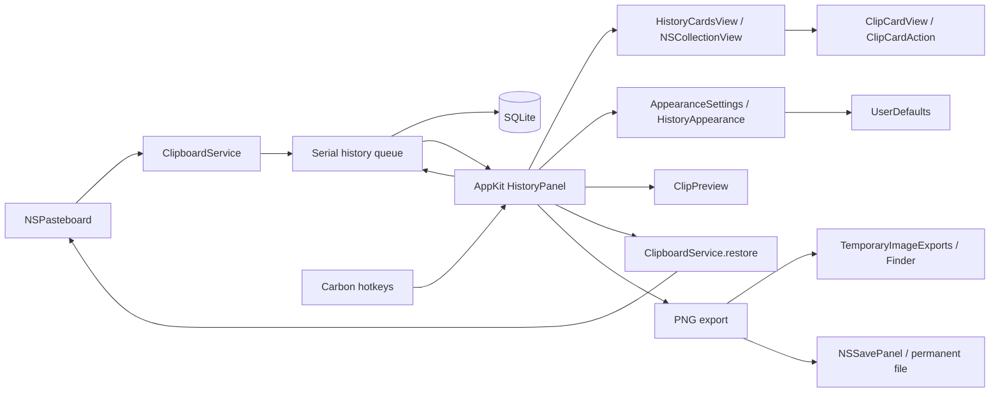

# Границы первой версии

Минимальная система — macOS 14; значение согласовано в SwiftPM и метаданных пакета приложения. Встроенные модели пока не подключены; первый этап их поддержки рассчитан на Apple Silicon.

`BufferaCore` содержит сериализуемый контракт содержимого и SQLite. `HistoryStore` используется только на одной последовательной очереди; все SQL-параметры связаны через prepared statements. Отдельная таблица payloads не загружается при поиске. Транзакция включает вставку, дедупликацию и применение лимитов. Уникальный хеш учитывает границы элементов, типы и бинарные данные. Идентификаторы не переиспользуются, в том числе для имён экспорта.

Схема версии 6 содержит признаки `is_concealed`, `is_favorite`, таблицу `clip_ocr` и `clips.is_remote INTEGER NOT NULL DEFAULT 0 CHECK(is_remote IN (0,1))`. Миграции версий 0–5 выполняются в одной `BEGIN IMMEDIATE` с rollback при ошибке. Старым записям не приписывается удалённое происхождение: 0 означает отсутствие сохранённого признака. Существующие id, payload, избранное и результаты OCR не пересоздаются. Более новая неизвестная версия отклоняется без понижения.

`clips.sort_date` отделяет порядок использования от даты копирования `date`: миграция заполняет его прежней датой и создаёт индекс сортировки. Вставка и дедупликация обновляют обе даты. `markUsed(id:date:)` меняет только `sort_date`, без payload, источника, признаков и OCR; отсутствие записи возвращает `HistoryError.missing`. Поиск и очистка лимитов используют `sort_date DESC, id DESC`, календарный фильтр и очередь OCR — прежнюю дату копирования.

`HistoryStore.nearby(anchorID:before:after:)` читает актуальную опору по id и ближайшие строки по `(date,id)` на той же последовательной очереди. По умолчанию возвращается до 10 более ранних и 10 более поздних записей вместе с опорой, в порядке `date DESC,id DESC`; одинаковые даты разделяются по id. Каждая сторона ограничена 0–100 записями. Запросы используют существующий индекс `clips_date` и общий декодер `ClipSummary`, не загружают payload или OCR и не принимают поисковых фильтров. Отсутствующая опора возвращает `HistoryError.missing`. Схема остаётся версии 6: отдельного журнала копирований нет, повторный захват заменяет прежнюю дату и источник. Выбор через Buffera хронологию соседей не меняет.

`HistoryStore.setFavorite(id:isFavorite:)` атомарно устанавливает точный флаг, допускает повторную установку того же значения и возвращает `HistoryError.missing` для отсутствующего id. Дедупликация и ручное скрытие не меняют избранное. Общий предикат `search`/`count` комбинирует `SearchFilter.favoritesOnly` с остальными условиями. Оконные функции автоматической очистки считают позиции и сумму bytes только среди `is_favorite=0`: избранное находится вне лимитов. Снятие флага не запускает очистку; обычные лимиты применяются при следующей вставке. Явный `delete` по-прежнему удаляет запись вместе с payload.

`ClipboardService` работает с AppKit на главном потоке. Данные копируются из NSPasteboardItem до передачи на очередь хранения. После чтения сверяется changeCount; устаревший снимок отбрасывается. Восстановление создаёт новые NSPasteboardItem и обновляет lastChange, чтобы избежать петли захвата.

`com.apple.is-remote-clipboard` сохраняется как отдельный `isRemote` до удаления служебных представлений из payload. Для удалённой записи source остаётся пустым; карточка показывает «С другого устройства». Идентификатор устройства из этого маркера недоступен. Для местной записи источник берётся из `org.nspasteboard.source`; явное пустое/неизвестное значение не заменяется активным приложением. Только при отсутствии маркера используется имя активного приложения, кроме loginwindow и WindowServer. При дедупликации source, isRemote и дата соответствуют последнему копированию. `sources()` исключает удалённые записи, UI также скрывает собственное приложение и системные процессы. Общий предикат search/count поддерживает `remoteOnly` и `concealedOnly`. В UI `HistoryContentType` задаёт один выбранный тип: обычный ClipKind, «С устройств» или «Скрытые». Сайдбар и подменю «Тип» используют один список вариантов и один обработчик выбора; новый тип заменяет прежний и преобразуется в соответствующие поля SearchFilter. Тип не меняет дату, приложение, раздел истории/избранного и сохраняется до сброса или перезапуска.

`ClipboardSessionMonitor` проверяет снимок `CGSessionCopyCurrentDictionary` и наблюдает отдельные уведомления блокировки, смены активного сеанса и сна. `CGSSessionScreenIsLocked` и имена distributed-уведомлений не являются документированным контрактом Apple; механизм изолирован в мониторе. При недоступном снимке захват запрещён. `ClipboardService.poll()` проверяет разрешение до и после чтения, а каждый переход сеанса обновляет changeCount без чтения содержимого. Так пропускаются изменения во время блокировки, включая цикл блокировка/разблокировка между опросами. Ручная пауза независима. Уже принятые до блокировки записи могут завершить запись на последовательной очереди. Universal Clipboard, доставленный только после возвращения в сеанс, не содержит времени исходного копирования, поэтому отличить такой случай от нового копирования нельзя.

По выбранному пользователем режиму `ConcealedType` и `com.agilebits.onepassword` означают сохранение с маской. Эти маркеры имеют приоритет над `TransientType`/`AutoGeneratedType`; без конфиденциального маркера временные и автоматически созданные записи пропускаются. Полный исходный payload остаётся в базе без отдельного шифрования. `HistoryStore.insert` независимо от вызывающего кода заменяет заголовок на «Скрытая запись», очищает text и строит search только из безопасного заголовка и source. При конфликте fingerprint флаг сохраняется через `MAX`, а metadata остаётся очищенной даже при новом `isConcealed=false`.

Ручной `conceal(id:)` выполняет чтение source и очистку metadata в одной транзакции, не меняя payload. В UI «Скрыть» доступно для обычного текста и ссылок. «Показать» декодирует текст по явному действию и хранит не более 4000 символов только в состоянии панели; отдельный `revealToken`, выбранный id и видимость окна отсеивают поздний ответ. Смена выбора, обновление списка или закрытие сбрасывают раскрытие. Скрытые записи не создают миниатюры или подсказки с содержимым, доступное описание до раскрытия — «Скрытая запись». Временный показ не меняет флаг в SQLite.

`HotKeys` владеет регистрациями и обработчиком на `GetEventDispatcherTarget()`. V глобальна, C регистрируется только при открытом окне. Проверяются signature и id событий нажатия/отпускания; уже зажатые id позволяют отсеять автоматический повтор. Регистрация V идемпотентна; после конфликта её можно повторить из меню, также она повторяется при завершении другого приложения. Повторное нажатие перед завершением активации направляется в уже видимую панель и не перезапускает загрузку.

`HistoryShortcutGesture` считает отдельные нажатия в пределах начального удержания `⌘⌥`, которым открыта панель. Одно нажатие с отпусканием оставляет окно в обычном режиме до следующего открытия; последующие V/C только двигают выбор. Второе нажатие без отпускания начального удержания включает выбор при отпускании любого обязательного модификатора. Жест запускается только в `open(fromShortcut: true)`, а `HistoryPanel.shortcutPressed` продолжает его лишь пока он активен; Carbon и прямые оконные события используют этот общий путь. `flagsChanged` дополняется опросом `NSEvent.modifierFlags` каждые 25 мс только во время начального жеста, чтобы заметить отпускание до получения окном фокуса; дополнительных разрешений не требуется. Отпускание после перебора вызывает обычный `confirm()`, включая ожидание первой загрузки. Закрытие, ошибка и подтверждение сбрасывают жест и таймер; открытие через меню остаётся обычным, а Escape отменяет отложенный выбор.

`HistoryPanel` управляет выбором в окне, которое остаётся открытым после вызова. Enter или двойной щелчок фиксируют id выбранной записи; подтверждение до завершения первой загрузки откладывается до её результата. На время подтверждения выбор, поиск и фильтры заблокированы. `PickerWindow.sendEvent` обрабатывает клавиши панели до поля поиска, а делегат поля дополнительно обрабатывает команду Enter. `AppDelegate` читает payload зафиксированного id, восстанавливает системный буфер и только после успеха ставит `markUsed` на ту же последовательную очередь перед закрытием окна. Следующий запрос видит новый порядок. Ошибка изменения порядка показывается через существующий статус ошибок без повторного копирования. Окно закрывается с возвратом фокуса предыдущему приложению.

Поисковые ответы защищены номером `searchGeneration`, загрузки содержимого — `generation`, а подтверждение — отдельным `confirmationToken`: поисковое обновление не отменяет уже выбранную запись. Escape, закрытие и повторное открытие инвалидируют ожидающее подтверждение, поэтому позднее чтение payload не меняет буфер после отмены. Потеря фокуса также закрывает окно; календарный поповер, просмотр, настройки внешнего вида, контекстное меню карточки и NSSavePanel временно могут владеть ключевым статусом без отмены сессии.

Окно — обычная активирующаяся `NSPanel` с `hidesOnDeactivate=false`. Глобальный вызов активирует Buffera, делает панель ключевой и переводит фокус в список; после асинхронной активации фокус назначается повторно. Начало печати из списка создаёт новый запрос и переводит фокус в поиск; `⌘F` позволяет редактировать существующий запрос. Решение «переместить выбор или открыть панель» учитывает видимость, ключевой статус и дочерние взаимодействия. Системный Logger с subsystem `local.buffera.app` записывает только регистрацию клавиш, жизненный цикл панели и результат подтверждения, без содержимого буфера.

Запрос, `HistoryFilters` и раздел «История»/«Избранное» остаются в памяти `HistoryPanel` между закрытиями окна; `open()` повторно загружает результаты без сброса этих значений. В UserDefaults они не записываются и после перезапуска приложения начинаются заново. Кнопка «Вся история» и `⌘0` явно очищают запрос, фильтры и раздел. Повторные клавиши навигации во время первой загрузки накапливаются в знаковом `pendingMoveDelta` и применяются к восстановленному выбору. Это состояние отделено от постоянных настроек внешнего вида.

Для временного просмотра соседей `NearbyHistoryState` сохраняет строки исходного поиска, счётчик, выбранный id и позицию прокрутки. Поисковые контролы остаются с прежними значениями, но блокируются; обычная пагинация и обновления OCR не подменяют соседей. `requestNearby` проходит через `AppDelegate` на общую очередь хранения. Отдельный `nearbyToken`, id опоры и видимость окна отсеивают устаревшие ответы и ошибки; `onNavigate` инвалидирует прежние запросы поиска, содержимого и подтверждения. Вход отменяет просмотр и временное раскрытие секрета. Карточки, миниатюры, действия и подтверждение используются существующие, опора получает отдельную метку, независимую от выбора. Смена опоры сохраняет первоначальную точку возврата.

Копирования и изменения OCR отмечают сохранённый поиск как требующий обновления, не переставляя текущих соседей. Изменение избранного отмечает его до асинхронной записи; скрытие и удаление перезапрашивают соседей после завершения. При возврате после изменений панель запрашивает свежие строки, сохраняет исходный выбор и прокрутку и не рисует старый снимок. Закрытие завершает временный режим и также не восстанавливает устаревшие карточки на время анимации; следующий `open()` загружает исходный поиск. При отсутствии изменений возврат использует сохранённые строки. Escape сначала закрывает просмотр, затем возвращает поиск; ошибка или удаление опоры оставляет доступным возврат.

После `insert` панель получает id внешнего копирования. `captureSelectionToken` присваивается на главном потоке при захвате и меняется после успешного восстановления: запоздалое уведомление о более раннем копировании не возвращает старый выбор. Он имеет приоритет при следующей загрузке, только если запись есть в текущих результатах; неподходящее копирование не сбрасывает фильтры и прежнее выделение. Успешное подтверждение завершает этот приоритет. Esc и уход фокуса сохраняют выбор, в том числе если список ещё загружается. Повторное открытие запрашивает ранее загруженную глубину; при необходимости запрос расширяется до сохранённого id. Отложенное закрытие по потере фокуса защищено `presentationToken`, а жест быстрого выбора отменяется сразу при настоящем уходе фокуса.

После успешного `setFavorite` callback передаёт подтверждённый флаг и id. Панель обновляет текущую запись и кнопку звезды на месте, без очистки списка или пересоздания всех карточек. В разделе избранного снятая запись удаляется точечно; сохраняется существующий выбор либо выбирается ближайший сосед. `pendingFavorites` блокирует повторный запрос для того же id и новую пагинацию избранного до завершения изменений, чтобы удаление не сдвинуло ожидаемый offset. Ошибка снимает блокировку и показывает сообщение, не сбрасывая состояние всей панели.

`HistoryFilters` владеет одним состоянием типа, даты и приложения. В боковом меню сверху расположены типы, затем период и приложения. Компактная кнопка фильтров рядом с поиском открывает нативное меню типа, даты, приложения и сброса; оно доступно и при скрытии сайдбара кнопкой или `⌘⌥S`. Отдельной строки фильтров над карточками нет. Переключение представления фильтры не сбрасывает. Дата остаётся поповером с быстрыми периодами «Всё время», «Сегодня», «Вчера», «7 дней», «30 дней» и двумя `NSDatePicker` в режиме календаря. Границы приводятся к локальным началам дней, порядок нормализуется, верхняя граница SQL равна началу дня после выбранной даты. Поэтому пользовательский конец периода включён целиком; 7/30 дней включают сегодня.

Окно `.resizable` использует `NSVisualEffectView` с материалом `.popover` и смешиванием `.behindWindow`. Стандартные кнопки закрытия, сворачивания и разворачивания скрыты. `HistoryAppearance` сохраняет в отдельных ключах `historyAppearance.*` режим `.floating/.left/.right`, 1–4 колонки, 3–12 видимых строк и видимость бокового меню. Неверные типы получают значения по умолчанию, числовые значения ограничиваются допустимыми границами. `SettingsWindow` — отдельное сохраняемое окно, доступное через шестерёнку, `⌘,` и меню приложения. Оно сохраняет настройки сразу и передаёт компоновку панели через callback; `HistoryLimits` обслуживает настройки хранения и захват. Геометрия истории меняется без её показа и перехвата фокуса.

Положение и размер обычного окна сохраняются под именем `BufferaHistory`; ширина боковой панели без меню — отдельно в `historyAppearance.sideWidth`. Переход в боковой режим не перезаписывает обычную геометрию. Боковая панель располагается у выбранного края видимой области экрана под указателем, занимает доступную высоту и учитывает число колонок, ширину меню и границы экрана. При открытии и закрытии она сдвигается за край; `presentationToken` отменяет устаревшие шаги анимации, а `isClosing` блокирует ввод во время закрытия. Системный Reduce Motion отключает анимацию. Перед показом обычного окна его рамка проверяется относительно текущих экранов и возвращается в видимую область при необходимости.

`HistoryCardsView` владеет `NSCollectionView`, повторно используемыми ячейками, прокруткой и раскладкой; записи и действия остаются в `HistoryPanel`. `HistoryCardsMetrics` рассчитывает фактическое число колонок по доступной ширине: минимум ширины — 230 точек, промежуток — 8. Число видимых строк задаёт высоту обычных карточек (минимум 96 точек) и ограничивает высоту текста в боковых панелях. В панелях `NSCollectionViewDelegateFlowLayout` запрашивает высоту по содержимому; `ClipCardView` измеряет тот же текст и шрифт, что показывает, с учётом ширины и места под действия. Короткая запись занимает от 74 точек, картинка — от 106; скрытая запись измеряется по точкам, без доступа к длине секрета. Карточки одной строки сетки получают максимальную высоту в этой строке. Кеш измерений сбрасывается при изменении ширины, плотности, режима или данных; пагинация сохраняет измерения старых записей. Изменение размера окна перестраивает раскладку, загрузка страницы добавляет элементы, а изменение избранного обновляет или удаляет отдельную ячейку без мерцания всего списка. В сетке `↑/↓` смещают выбор на фактическое число колонок, `←/→` — на одну запись; глобальные `⌘⌥V/C` всегда перебирают линейную последовательность. `Tab` переводит фокус между карточками и поиском.

`ClipCardView` отвечает только за представление записи и callbacks. Кнопки допустимых для записи действий постоянно видны внутри карточки, выбранная карточка имеет обводку. `ClipCardAction` задаёт названия, символы, доступность и подсказки сочетаний для кнопок и контекстного меню: Enter — копирование, пробел/`⌘Y` — просмотр, `⌘D` — избранное, `⇧⌘N` — соседи, `⇧⌘C` — скопировать иначе, `⇧⌘H` — скрытие/показ, `⇧⌘R` — Finder, `⇧⌘S` — сохранение, `⌘⌫` — удаление. Удаление доступно через контекстное меню и клавиатуру; экспорт — только для нескрытых картинок. Кнопки, меню и клавиатура передают действие в `HistoryPanel.perform`, который фиксирует id и вызывает существующие операции `AppDelegate`. Нажатие действия не прокручивает карточку принудительно. Удержание Command показывает метки `⌘1`–`⌘9` у первых девяти результатов; сочетание сразу подтверждает соответствующую запись.

`ClipPreview` показывает временный `NSPopover`, не создавая экспортный файл. Payload читается и декодируется на очереди истории: текст ограничен 500 000 символов для просмотра, изображение уменьшается ImageIO до 1600 пикселей, для файлов показываются пути, для прочих данных — перечень форматов. Панель проверяет поколение запроса, отдельный `previewToken`, видимость и выбранный id перед показом. Смена выбора, обновление и закрытие отменяют предыдущий просмотр. Пробел открывает его только вне редактирования поиска; `⌘Y` работает также из поля поиска. В просмотре пробел/Escape закрывают поповер, Enter подтверждает запись, стрелки закрывают просмотр и перемещают выбор. Закрытие освобождает контроллер с декодированным содержимым. Скрытый payload не декодируется этим путём: сначала требуется явный показ, после которого просмотр использует уже раскрытые 4000 символов.

Миниатюры загружаются через `requestThumbnail`: payload читается и передаётся ImageIO на очереди истории, а результат возвращается с проверкой поколения запроса. ImageIO уменьшает PNG/TIFF до 320 пикселей для высоких карточек и Retina; панель кеширует до 150 миниатюр. Замыкание удерживает конкретную ячейку слабо, поэтому поздний ответ не меняет другую строку. Повреждённое изображение оставляет значок типа; исходный payload и путь экспорта не меняются.

`TextTransformation` в ядре содержит чистые преобразования текста и их русские названия/описания. JSON разбирается по грамматике и форматируется с сохранением исходных лексем строк, чисел и ключей; ограничения входа, результата и глубины проверяются до возврата. Очистка URL фильтрует исходные сегменты query, не пересобирая нетронутые компоненты через URLComponents.

`CopyTransformOperation` определяет доступные действия для нескрытых text/link/image. `CopyTransformService` читает актуальные `summary(id:)`, payload и готовый `imageText(id:)` на общей очереди SQLite. Декодирование через общий per-item метод `ClipboardService.text(in:)`, преобразование и OCR выполняются на отдельной последовательной очереди. Для преобразований каждый item должен иметь читаемый текст: частичный результат не допускается. Готовый OCR переиспользуется, при отсутствии запускается существующий `ImageTextRecognizer`. После обработки сервис повторно проверяет существование и доступность записи. Изменений схемы нет.

`CopyTransformMenu` используется как подменю карточки и как отдельное меню кнопки/сочетания клавиш. Панель заранее запрашивает варианты только для выбранной записи. `CopyTransformService.operations` проверяет полный текст теми же преобразованиями, которые используются при копировании; действия без изменений и неподходящие варианты исключаются. Для строк дополнительно требуется реальная склейка соседних строк или точный повтор непустой строки. OCR при открытии меню не запускается; известный пустой или ограниченный результат исключает действие. Ответ доставляется в common/eventTracking-режимах главного RunLoop и обновляет уже открытое меню. Поколения запросов отсекают ответы для прежнего выбора.

Выбор пункта сразу запускает преобразование и копирование. Панель фиксирует ID источника, инвалидирует незавершённый поиск и блокирует новые действия на время обработки. Захват и OCR отмечают историю для обновления после ошибки или отмены. Esc отменяет ожидающее копирование и оставляет историю открытой; закрытие окна также инвалидирует токены. Перед записью `AppDelegate` снова проверяет источник на очереди хранения и актуальность операции, затем использует общий с обычным выбором `restoreClipboard`: `ClipboardService.restore` → подавление собственного захвата → `markUsed`. В буфер записывается только полный UTF-8 текст; payload исходника не переписывается.

`TemporaryImageExports` создаёт файлы для Finder в системной временной папке `local.buffera.app/ImageExports`. Запись атомарная, каталог имеет режим 0700, файлы — 0600. Повторный экспорт id заменяет файл и обновляет время. Очистка выполняется при запуске, каждый час и перед/после экспорта: файлы старше 24 часов удаляются, затем самые старые удаляются до лимита 256 МиБ. Текущий экспорт защищён от очистки; отдельный файл больше лимита отклоняется. Обрабатываются только обычные файлы собственного шаблона имён без символических или жёстких ссылок; доступ к кешу защищён lock.

«Сохранить как…» пишет PNG в выбранный NSSavePanel путь, обходя временный кеш. Скопированный пользователем в другую папку файл становится независимой копией и не участвует в очистке. Ни исходный payload истории, ни постоянные файлы, ни прежняя папка `Application Support/Buffera/Exports` временной очисткой не затрагиваются.

## Проверенные внешние контракты

| Граница | Источник | Защита |
| --- | --- | --- |
| Элементы буфера становятся недействительными после смены владельца | [NSPasteboardItem](https://developer.apple.com/documentation/appkit/nspasteboarditem) | Копирование Data, проверка changeCount |
| Нельзя повторно записывать объект, уже привязанный к буферу | Там же | Новые объекты при restore |
| Чтение может вернуть nil | [pasteboardItems](https://developer.apple.com/documentation/appkit/nspasteboard/pasteboarditems), data(forType:) | Пустой буфер пропускается; недоступный формат сообщает ошибку |
| Регистрация сочетания может конфликтовать | CarbonEvents.h из установленного SDK, RegisterEventHotKey | Проверка OSStatus, меню остаётся доступным |
| SQLite-операции могут завершиться ошибкой | sqlite3.h из установленного SDK | Проверка кодов, rollback, ошибка в меню |

## Отказы и восстановление

- Смена буфера во время чтения → снимок пропускается, следующее изменение читается новым циклом.
- Слишком большой элемент или недоступное представление → история не получает частичный элемент, ошибка доступна в меню, основной буфер не меняется.
- Ошибка записи/декодирования базы → сообщение, без сброса или пересоздания пользовательской истории.
- Ошибка миграции или ручного скрытия → rollback и сообщение, без частично изменённой записи; отсутствующий id при скрытии возвращает `HistoryError.missing`.
- Ошибка изменения избранного → сообщение и снятие блокировки действия; карточка меняется только после успешной записи. Отсутствующий id возвращает `HistoryError.missing`, история не пересоздаётся.
- Ошибка чтения или декодирования просмотра → сообщение внутри поповера; исходный payload и системный буфер не меняются. Поздний результат для другого выбора отбрасывается.
- Ошибка записи в системный буфер → окно остаётся открытым, сообщение. macOS не предоставляет транзакцию для clearContents/writeObjects; при отказе writeObjects прежнее содержимое может быть уже очищено.
- Ошибка экспорта → запись истории остаётся, сообщение; файл пишется атомарно.
- Ошибка очистки временного кеша → сообщение в меню; новый экспорт, если его подготовка/очистка не удалась, не открывается в Finder. Постоянные сохранения не зависят от этого кеша.
- Конфликт сочетания → сообщение с рекомендацией закрыть Pasta; история доступна через меню.

## Следующие независимые расширения

OCR через Apple Vision (`VNRecognizeTextRequest`) уже формирует отдельный поисковый текст, не изменяя исходное содержимое. Будущие эмбеддинги остаются производным индексом, локальная LLM — необязательным потребителем общего поиска. Запись истории и обычный поиск не должны зависеть от их доступности. Согласованные этапы и отложенные идеи перечислены в [ideas.md](ideas.md).

## Полное переименование

Swift-пакет и executable — `Buffera`, основной модуль — `BufferaCore`, проверки — `BufferaChecks`; системный идентификатор — `local.buffera.app`. Перед созданием меню и открытием базы `AppDelegate` проверяет отсутствие предыдущей версии, затем вызывает `LegacyMigration`. Целиком перемещается прежняя папка истории в `Application Support/Buffera`: SQLite, WAL/SHM, резервные копии и постоянные экспорты. Два существующих каталога, файлы и символьные ссылки вызывают ошибку запуска; данные не объединяются и не перезаписываются.

Настройки переносятся в новый UserDefaults domain только по известным ключам. Имена рамок окон и положения значка преобразуются, существующие новые значения имеют приоритет. Старый домен остаётся для восстановления; маркер завершения записывается вместе со значениями. Новые временные экспорты используют новое имя; прежний кеш продолжает участвовать в очистке с общим лимитом 256 МиБ. Старые идентификаторы остаются только в совместимости и исторических протоколах проверки.
