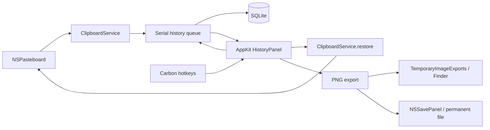

# Границы первой версии

`BuferaCore` содержит сериализуемый контракт содержимого и SQLite. `HistoryStore` используется только на одной последовательной очереди; все SQL-параметры связаны через prepared statements. Отдельная таблица payloads не загружается при поиске. Транзакция включает вставку, дедупликацию и применение лимитов. Уникальный хеш учитывает границы элементов, типы и бинарные данные. Идентификаторы не переиспользуются, в том числе для имён экспорта.

Схема версии 2 добавляет `clips.is_concealed INTEGER NOT NULL DEFAULT 0`. Миграция базы версии 0/1 выполняется в `BEGIN IMMEDIATE` с `ALTER TABLE`, обновлением `user_version` и rollback при ошибке. Существующие id, записи и payload не пересоздаются. Повторное открытие версии 2 не меняет версию; более новая неизвестная версия отклоняется без понижения.

`ClipboardService` работает с AppKit на главном потоке. Данные копируются из NSPasteboardItem до передачи на очередь хранения. После чтения сверяется changeCount; устаревший снимок отбрасывается. Восстановление создаёт новые NSPasteboardItem и обновляет lastChange, чтобы избежать петли захвата.

Источник берётся из `org.nspasteboard.source`, если bundle identifier удаётся сопоставить приложению; иначе используется имя активного приложения. В базе сохраняется имя, а не стабильный идентификатор приложения. При дедупликации источник и дата обновляются: фильтр описывает последнее копирование. `SearchFilter.source` задаёт точное равенство через связанный параметр в общем предикате `search` и `count`. `sources()` возвращает все уникальные непустые имена из истории с сортировкой без учёта регистра.

По выбранному пользователем режиму `ConcealedType` и `com.agilebits.onepassword` означают сохранение с маской. Эти маркеры имеют приоритет над `TransientType`/`AutoGeneratedType`; без конфиденциального маркера временные и автоматически созданные записи пропускаются. Полный исходный payload остаётся в базе без отдельного шифрования. `HistoryStore.insert` независимо от вызывающего кода заменяет заголовок на «Скрытая запись», очищает text и строит search только из безопасного заголовка и source. При конфликте fingerprint флаг сохраняется через `MAX`, а metadata остаётся очищенной даже при новом `isConcealed=false`.

Ручной `conceal(id:)` выполняет чтение source и очистку metadata в одной транзакции, не меняя payload. В UI «Скрыть» доступно для обычного текста и ссылок. «Показать» декодирует текст по явному действию и хранит не более 4000 символов только в состоянии панели; отдельный `revealToken`, выбранный id и видимость окна отсеивают поздний ответ. Смена выбора, обновление списка или закрытие сбрасывают раскрытие. Скрытые записи не создают миниатюры или подсказки с содержимым, доступное описание до раскрытия — «Скрытая запись». Временный показ не меняет флаг в SQLite.

`HotKeys` владеет регистрациями и обработчиком на `GetEventDispatcherTarget()`. V глобальна, C регистрируется только при открытом окне. Проверяются signature и id события. Регистрация V идемпотентна; после конфликта её можно повторить из меню, также она повторяется при завершении другого приложения. Отпускание клавиш не обрабатывается: таймера автоматического подтверждения нет.

`HistoryPanel` управляет выбором в окне, которое остаётся открытым после вызова. Enter или двойной щелчок фиксируют id выбранной записи; подтверждение до завершения первой загрузки откладывается до её результата. На время подтверждения выбор, поиск и фильтры заблокированы. `PickerWindow.sendEvent` обрабатывает клавиши панели до поля поиска, а делегат поля дополнительно обрабатывает команду Enter. `AppDelegate` читает payload зафиксированного id, восстанавливает системный буфер и после успеха закрывает окно с возвратом фокуса предыдущему приложению.

Поисковые ответы защищены номером `generation`, а подтверждение — отдельным `confirmationToken`: поисковое обновление не отменяет уже выбранную запись. Escape, закрытие и повторное открытие инвалидируют ожидающее подтверждение, поэтому позднее чтение payload не меняет буфер после отмены. Потеря фокуса также закрывает окно; календарный поповер и NSSavePanel временно могут владеть ключевым статусом без отмены сессии.

Окно — обычная активирующаяся `NSPanel` с `hidesOnDeactivate=false`. Глобальный вызов активирует Bufera, делает панель ключевой и переводит фокус в поиск; после асинхронной активации фокус назначается повторно. Решение «переместить выбор или открыть панель» учитывает видимость, ключевой статус, открытый календарь и лист сохранения. Системный Logger с subsystem `local.bufera.app` записывает только регистрацию клавиш, жизненный цикл панели и результат подтверждения, без содержимого буфера.

`HistoryFilters` содержит кнопки типа, даты и приложения с подсветкой активного выбора и общим сбросом. Тип и приложение используют нативные меню; дата — поповер с быстрыми периодами «Всё время», «Сегодня», «Вчера», «7 дней», «30 дней» и двумя `NSDatePicker` в режиме календаря. Границы приводятся к локальным началам дней, порядок нормализуется, верхняя граница SQL равна началу дня после выбранной даты. Поэтому пользовательский конец периода включён целиком; 7/30 дней включают сегодня.

Окно `.resizable` использует один список на всю ширину и `NSVisualEffectView` с материалом `.popover` и смешиванием `.behindWindow`. Минимальные размеры задаются Auto Layout; внизу остаются действия экспорта выбранной картинки. Геометрия хранится стандартным `NSWindow` autosave под именем `BuferaHistory`; открытие не центрирует окно повторно. Перед показом рамка проверяется относительно текущих экранов и при необходимости возвращается в видимую область.

Миниатюры загружаются через `requestThumbnail`: payload читается и передаётся ImageIO на очереди истории, а результат возвращается с проверкой поколения запроса. ImageIO уменьшает PNG/TIFF до 96 пикселей; панель кеширует до 150 миниатюр. Замыкание удерживает конкретную ячейку слабо, поэтому поздний ответ не меняет другую строку. Повреждённое изображение оставляет значок типа; исходный payload и путь экспорта не меняются.

`TemporaryImageExports` создаёт файлы для Finder в системной временной папке `local.bufera.app/ImageExports`. Запись атомарная, каталог имеет режим 0700, файлы — 0600. Повторный экспорт id заменяет файл и обновляет время. Очистка выполняется при запуске, каждый час и перед/после экспорта: файлы старше 24 часов удаляются, затем самые старые удаляются до лимита 256 МиБ. Текущий экспорт защищён от очистки; отдельный файл больше лимита отклоняется. Обрабатываются только обычные файлы собственного шаблона имён без символических или жёстких ссылок; доступ к кешу защищён lock.

«Сохранить как…» пишет PNG в выбранный NSSavePanel путь, обходя временный кеш. Скопированный пользователем в другую папку файл становится независимой копией и не участвует в очистке. Ни исходный payload истории, ни постоянные файлы, ни прежняя папка `Application Support/Bufera/Exports` временной очисткой не затрагиваются.

## Проверенные внешние контракты

| Граница | Источник | Защита |
| --- | --- | --- |
| Элементы буфера становятся недействительными после смены владельца | [NSPasteboardItem](https://developer.apple.com/documentation/appkit/nspasteboarditem) | Копирование Data, проверка changeCount |
| Нельзя повторно записывать объект, уже привязанный к буферу | Там же | Новые объекты при restore |
| Чтение может вернуть nil | [pasteboardItems](https://developer.apple.com/documentation/appkit/nspasteboard/pasteboarditems), data(forType:) | Пустой буфер пропускается; недоступный формат сообщает ошибку |
| Регистрация сочетания может конфликтовать | CarbonEvents.h из установленного SDK, RegisterEventHotKey | Проверка OSStatus, меню остаётся доступным |
| SQLite-операции могут завершиться ошибкой | sqlite3.h из установленного SDK | Проверка кодов, rollback, ошибка в меню |

## Отказы и восстановление

- Смена буфера во время чтения → снимок пропускается, следующее изменение читается новым циклом.
- Слишком большой элемент или недоступное представление → история не получает частичный элемент, ошибка доступна в меню, основной буфер не меняется.
- Ошибка записи/декодирования базы → сообщение, без сброса или пересоздания пользовательской истории.
- Ошибка миграции или ручного скрытия → rollback и сообщение, без частично изменённой записи; отсутствующий id при скрытии возвращает `HistoryError.missing`.
- Ошибка записи в системный буфер → окно остаётся открытым, сообщение. macOS не предоставляет транзакцию для clearContents/writeObjects; при отказе writeObjects прежнее содержимое может быть уже очищено.
- Ошибка экспорта → запись истории остаётся, сообщение; файл пишется атомарно.
- Ошибка очистки временного кеша → сообщение в меню; новый экспорт, если его подготовка/очистка не удалась, не открывается в Finder. Постоянные сохранения не зависят от этого кеша.
- Конфликт сочетания → сообщение с рекомендацией закрыть Pasta; история доступна через меню.

## Следующие независимые расширения

OCR через Apple Vision (`VNRecognizeTextRequest`) может формировать отдельный поисковый текст, не изменяя исходное содержимое. Эмбеддинги и локальная LLM также должны быть производными индексами: запись истории и обычный поиск не должны зависеть от их доступности.
