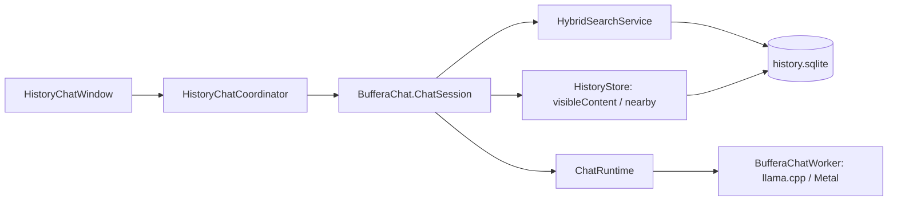

# Спросить Buffera

В «Настройки → Поиск и ответы» указаны название и размер языковой модели. Кнопка «Скачать модель и включить» запускает её подготовку, а уже скачанную модель включает переключатель функции. Кнопка «Спросить» рядом с поиском по смыслу открывает локальную LLM, которая может искать и читать историю буфера обмена.

Этап 7 использует существующие историю, поиск и скачанную Gemma 4 E2B. Новых сетевых сервисов и миграции SQLite нет.

## Разделение ответственности

- `HistoryChatWindow` показывает переписку, статус и типизированные кнопки источников. Сгенерированный текст не исполняется и не открывает URL.
- `HistoryChatCoordinator` связывает окно и сессию, отменяет задачи, отсеивает запоздавшие события номером поколения и открывает источники через обычную историю без вызова копирования.
- `ChatSession` хранит ограниченный контекст разговора в памяти, организует до четырёх решений поиска/чтения и передаёт найденные документы в отдельный запрос генерации ответа.
- `ChatHistoryReader` использует общие операции Core/Search. `HistoryTextContent` — общая с MCP проекция текста, путей файлов и сохранённого OCR. Разрешение внешнего MCP к встроенному чату не применяется.
- `ChatRuntime` проверяет доступность и целостность модели, управляет приватным процессом и принимает поток UTF-8 через анонимные каналы. Worker использует закреплённый llama.cpp и общий пакет библиотек.

## Поиск и основания ответа

Планировщик получает текущее время, часовой пояс, имена приложений и ограниченные наблюдения. Он выбирает `search_history`, `read_clip`, `get_neighbors` или `finish` в JSON с проверкой допустимых ключей, типов и диапазонов. Неизвестные операции и вымышленные ID отклоняются, одинаковые вызовы не выполняются повторно. При некорректном плане выполняется ограниченный поиск по вопросу. Если поиск из нескольких слов пуст, допускаются две попытки с более коротким текстом при сохранении всех фильтров; фактический запрос сообщается планировщику.

После запроса соседей сессия читает ограниченное число соседних записей даже тогда, когда модель повторно читает только опору. В ответ передаются признаки опоры и соседей, чтобы их содержимое не смешивалось. Предыдущая переписка передаётся как справочные данные внутри запроса; текущий вопрос остаётся отдельным полем.

Скрытые записи всегда исключены. Чтение использует `visibleContent`; получить скрытое содержимое инструментом чата невозможно. Результаты повторно проверяются после асинхронной работы; во время выдачи ответа короткие снимки чтения проверяют, что источники ещё существуют и видимы. Снимки SQLite не удерживаются во время вычисления модели. Удаление или скрытие источника отменяет связанный разговор.

Источники нумеруются приложением, включают исходное время копирования и только прочитанные записи. Модель получает инструкцию ссылаться на них как `[1]`, `[2]`; реальные переходы строятся из типизированных `ChatSource`, а не из текста модели.

## Жизненный цикл

Разговор живёт до завершения приложения или «Нового разговора». Для уточнений используется ограниченный недавний контекст; доступность прежних источников проверяется заново, а обращение к их содержимому выполняется повторным чтением. История переписки и промежуточные результаты инструментов на диск не сохраняются.

Каждый запрос worker получает новый KV-контекст; веса переиспользуются. Отмена, закрытие окна, выключение/удаление модели и завершение приложения освобождают процесс. Дополнительный таймер освобождает его после простоя. Ограничение входа и выхода возвращается явным состоянием: данные не усекаются молча.

Служебные маркеры шаблона Gemma токенизируются отдельно от содержимого сообщений. Текст пользователя и истории не может стать специальными токенами шаблона. Содержимое не попадает в аргументы процесса и диагностические сообщения.

Проверки протокола и сценариев разговора выполняются на синтетической истории. Проверка реальной Gemma использует тот же `ChatSession` и собранный worker с отдельной временной базой.
