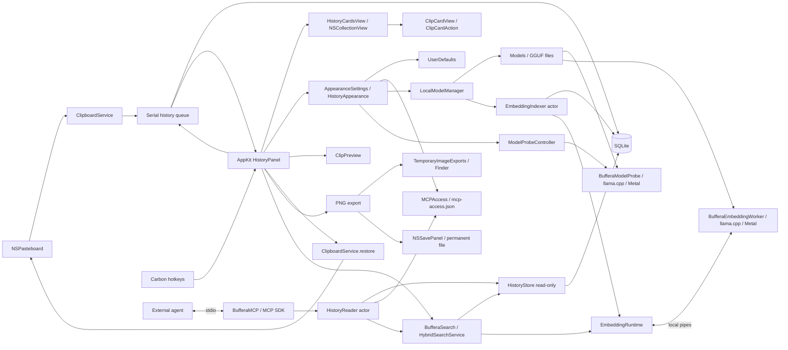

# Architecture

[Documentation](../README.md) · [Русский](../architecture.md) · English

The minimum system is macOS 14, consistently declared in SwiftPM and application bundle metadata. On Apple Silicon, the app includes local model downloading, management, and verification, background indexing, semantic search, and [history chat](chat.md).

`BufferaCore` contains the serializable content contract, SQLite, shared `ClipboardText` decoding, and `MCPAccess` permission. Each `HistoryStore` instance belongs to one serial queue or actor; all SQL parameters are bound through prepared statements. The separate payloads table is not loaded during search. A transaction covers insertion, deduplication, and limit enforcement. The unique hash includes item boundaries, types, and binary data. IDs are never reused, including for export filenames.

Schema version 10 contains `is_concealed`, `is_favorite`, the `clip_ocr` table, `clips.is_remote INTEGER NOT NULL DEFAULT 0 CHECK(is_remote IN (0,1))`, and separate tables for the semantic index and secret cleanup state. Migrations from versions 0–9 run in one `BEGIN IMMEDIATE`, with rollback on error. Old items are not assigned remote origin: 0 means no origin flag was saved. Existing IDs, payloads, favorites, and OCR results are not recreated. Version 10 adds `clips.label TEXT NOT NULL DEFAULT ''`: a user-defined favorite label, separate from content and stored in plaintext even for concealed items. `HistoryStore+Labels.swift` checks length and favorite status when writing; removing a star preserves the label. When concealed duplicates are merged, the surviving item's label is retained, or the deleted duplicate's label is used if the survivor has none. Labels do not enter the search index, MCP, or chat context. An unknown newer version is rejected without downgrading.

`clips.sort_date` separates use order from the copy date, `date`: migration fills it with the previous date and creates a sorting index. Insertion and deduplication update both dates. `markUsed(id:date:)` changes only `sort_date`, leaving the payload, source, flags, and OCR unchanged; a missing item returns `HistoryError.missing`. Search and limit pruning use `sort_date DESC, id DESC`; calendar filtering and the OCR queue use the original copy date.

`HistoryStore.nearby(anchorID:before:after:)` reads the current anchor by ID and the closest rows by `(date,id)` on the same serial queue. By default it returns up to 10 earlier and 10 later items with the anchor, ordered by `date DESC,id DESC`; IDs break ties between equal dates. Each side is limited to 0–100 items. Queries use the existing `clips_date` index and shared `ClipSummary` decoder, do not load payload or OCR, and accept no search filters. A missing anchor returns `HistoryError.missing`. There is no separate copy event log: recapturing replaces the previous date and source. Selecting through Buffera does not change neighbor chronology.

`HistoryStore.setFavorite(id:isFavorite:)` atomically sets the exact flag, permits setting the same value again, and returns `HistoryError.missing` for an absent ID. Deduplication and manual concealment do not change favorite status. The shared `search`/`count` predicate combines `SearchFilter.favoritesOnly` with other conditions. Automatic pruning's window functions count positions and sum bytes only among `is_favorite=0`: favorites are outside the limits. Removing the flag does not trigger pruning; ordinary limits apply on the next insertion. Explicit `delete` still removes the item together with its payload.

`ClipboardService` interacts with AppKit on the main thread. Data is copied from NSPasteboardItem before being sent to the storage queue. After reading, changeCount is checked and stale snapshots are discarded. Restore creates fresh NSPasteboardItem objects and updates lastChange to avoid a capture loop.

`com.apple.is-remote-clipboard` is saved as a separate `isRemote` flag before service representations are removed from the payload. Remote items keep an empty source; their cards show From another device. This marker provides no device identifier. For a local item, the source comes from `org.nspasteboard.source`; an explicitly empty or unknown value is not replaced with the foreground app. The foreground app name is used only when the marker is absent, excluding loginwindow and WindowServer. On deduplication, source, isRemote, and date reflect the most recent copy. `sources()` excludes remote items, and the UI also hides Buffera itself and system processes. The shared search/count predicate supports `remoteOnly` and `concealedOnly`. In the UI, `HistoryContentType` represents one selected type: an ordinary ClipKind, From devices, or Concealed. The sidebar and Type submenu share an option list and selection handler; a new type replaces the previous one and maps to the corresponding SearchFilter fields. Type does not change date, app, or the history/favorites section, and persists until reset or restart.

`ClipboardSessionMonitor` checks the `CGSessionCopyCurrentDictionary` snapshot and observes separate notifications for locking, active-session changes, and sleep. `CGSSessionScreenIsLocked` and the distributed notification names are not a documented Apple contract; this mechanism is isolated in the monitor. An unavailable snapshot blocks capture. `ClipboardService.poll()` checks eligibility before and after reading, and each session transition updates changeCount without reading content. This skips changes during locking, including a lock/unlock cycle between polls. Manual pause is independent. Items already accepted before locking may finish writing on the serial queue. Universal Clipboard delivered only after returning to the session carries no original copy timestamp, so that case cannot be distinguished from a new copy.

`SecretHistoryMode` is stored in UserDefaults and defaults to `skip`. `ClipboardService.savesConcealed` applies before representation data is requested: `ConcealedType` / `com.agilebits.onepassword` markers either skip the entire group or send it to the canonical `HistoryStore.insert`. The confidentiality marker takes precedence over transient/auto-generated markers; ordinary temporary items are skipped. The setting applies to new captures and does not delete existing saved secrets. An explicit Hide command encrypts an existing payload in either mode.

Encryption was introduced in schema 8: `payloads.encoding` (`0` for the previous binary plist, `1` for AES-GCM combined) and `secret_storage` with a key identifier. Schema 9 moves cleanup tasks into a separate singleton `secret_maintenance` table with `needs_checkpoint` and `needs_vacuum` flags; the former `secret_storage.needs_cleanup` is no longer used. The main process supplies `SecretPayloadCipher` with `KeychainSecretKeyProvider`; background indexers and MCP open the store without a provider. The random master key is 256 bits; HKDF-SHA256 derives separate AES-256-GCM and HMAC-SHA256 keys. CryptoKit generates a fresh nonce. AAD binds the format version and protected fingerprint, so swapping ciphertext between different items fails authentication. Ordinary payloads and SHA-256 fingerprints remain unchanged; secrets use HMAC fingerprints so the database does not contain a password hash that can be tested without the key.

`KeychainSecretKeyProvider` uses the file-based macOS Keychain with an ACL restricted to the main application; the key is cached in process memory. Denial blocks repeated uncached access, including creation of a key with a new UUID, until an explicit secret action: reveal, restore, drag, conceal, or enable encrypted mode. Ordinary captures and actions on visible items do not reset the denial. Modern access groups would require provisioning/signing that an ad-hoc build does not provide; the current mechanism does not use access groups. macOS may request permission after a signing change. If an existing key is missing, access is denied, or ciphertext is corrupt, there is no plaintext fallback for a secret item. A missing key or identifier is not automatically replaced when ciphertext exists. Ordinary capture continues when the key is unavailable; matching a previously concealed payload by HMAC is then impossible, so only a source marker guarantees recognition of a new copy as a secret. This fallback is allowed only for `keyUnavailable`: SQLite errors abort insertion.

Keychain access and key preparation happen before `BEGIN IMMEDIATE`; the transaction rechecks the identifier and uses an immutable `PreparedKey` without calling an external provider. A new identifier is registered in the same transaction as the secret. A rollback may leave an unused Keychain key, but does not replace an existing key. Reading the payload and concealment flag finishes before decryption, so a Keychain permission prompt does not hold a SQLite snapshot.

`insert` atomically updates the mask, ciphertext, fingerprint, indexes, and limits. Repeated copies retain concealment and favorite status when the key is available. `conceal` uses the same cipher and removes OCR/embeddings in the transaction. `restorablePayload` adds `ConcealedType` if a manually concealed item did not already have it. Title, text, and search contain only a safe mask and source; date, type, source, and size remain unencrypted. Secret content is not searched.

At startup, `protectLegacySecrets` encrypts old concealed payloads in one transaction on the history queue. On error, original items are not deleted, but reading legacy concealed plaintext is forbidden. The error is shown to the user; enabling encrypted mode retries the operation. After a successful `COMMIT`, insertion and concealment return success independently of database maintenance: cleanup does not delay panel updates or chat invalidation.

`secure_delete=ON` clears freed page content; ordinary concealment atomically sets only `needs_checkpoint`. `performSecretMaintenance` runs checkpoint/TRUNCATE at startup and then every 30 seconds on the same history queue. Cleanup uses a zero busy timeout: a busy reader leaves the flag for the next attempt, while an error is logged without a modal dialog. Old databases from versions 1–8 receive a separate one-time `needs_vacuum` task even when no key row exists; legacy plaintext migration also requires it. This clears old free pages left from before `secure_delete` was enabled. New databases and ordinary concealment do not require a full `VACUUM`. A successful `VACUUM` clears only its own flag; if the final checkpoint is busy, only the checkpoint is retried. The legacy `VACUUM` itself may temporarily occupy the queue and SQLite write lock. Flags survive restarts; previous backups and filesystem snapshots are not cleaned.

Manual `conceal(id:)` encrypts the payload, replaces its fingerprint, masks metadata, and removes OCR/embeddings in one transaction. In the UI, Hide is available for ordinary text and links. Reveal decodes text on explicit action and stores at most 4,000 characters only in panel state; a separate `revealToken`, selected ID, and window visibility reject late responses. Changing selection, refreshing the list, or closing clears the reveal. Text selection is disabled in a revealed secret's preview so the standard `NSTextView` cannot export it without the marker; Enter still restores the complete payload through `restorablePayload`. Ordinary preview text can be selected and copied. Concealed items produce no content thumbnails or tooltips; their accessibility description before reveal is Concealed item. Temporary revealing does not change the SQLite flag.

`HotKeys` owns registrations and the handler on `GetEventDispatcherTarget()`. The open/next-item command is global; the previous-item command is registered only while the window is open. `ShortcutPreferences` defines the modifiers and letters, defaulting to `⌘⌥V` and `⌘⌥C`. Press/release event signatures and IDs are checked; already-pressed IDs filter out autorepeat. Registering the open command is idempotent; it can be retried from the menu after a conflict and is also retried when another app exits. A repeat press before activation completes is routed to the already visible panel without restarting loading.

`HistoryShortcutGesture` counts distinct presses within the initial hold of the configured modifiers (by default `⌘⌥`) that opened the panel. One press followed by release leaves the window in ordinary mode until its next opening; subsequent next/previous-item key presses only move selection. A second press without releasing the initial hold enables confirmation when any required modifier is released. The gesture starts only in `open(fromShortcut: true)`, and `HistoryPanel.shortcutPressed` continues it only while active; Carbon and direct window events share this path. `flagsChanged` is supplemented by polling `NSEvent.modifierFlags` every 25 ms only during the initial gesture, detecting release before the window gains focus without additional permissions. Releasing after cycling calls the normal `confirm()`, including waiting for the first load. Closing, errors, and confirmation reset the gesture and timer; opening from the menu remains ordinary, and Escape cancels deferred selection.

`HistoryPanel` controls selection in a window that stays open after invocation. Enter or a double-click fixes the selected item's ID; confirmation before the first load finishes is deferred until the result arrives. Selection, search, and filters are locked during confirmation. `PickerWindow.sendEvent` handles panel keys before the search field, whose delegate additionally handles Enter. `AppDelegate` reads the payload of the fixed ID, restores the system clipboard, and only on success enqueues `markUsed` on the same serial queue before closing the window. The next query sees the new ordering. An ordering error is shown through the existing error status without copying again. The window closes and returns focus to the previous application.

When typing a query, changing filters, or reopening, `HistoryPanel.refresh(retainingCards: true)` keeps previous cards and thumbnails until the replacement result is ready. This is only a visual snapshot: its actions are disabled, while arrows and Enter apply to the incoming result. The first page replaces the whole list without an intermediate clear; an empty result or error removes old cards. If no snapshot exists on opening, including by hotkey, the window appears after data loads and cards are laid out. Repeated hotkey presses are retained during this wait; an outside click or app switch cancels pending presentation of an unpinned panel. Concealment, deletion, and other content changes use normal clearing `refresh`; confirmed concealment/deletion also invalidates the snapshot while the panel is closed. Checks: `Tests/HistoryPanelChecks/LoadingPresentationChecks.swift`.

Search responses are protected by `searchGeneration`, content loads by `generation`, and confirmation by a separate `confirmationToken`: refreshing search does not cancel an already selected item. Escape, closing, and reopening invalidate pending confirmation so late payload reads cannot change the clipboard after cancellation. Focus loss closes an unpinned window; the calendar popover, preview, appearance settings, card context menu, and NSSavePanel may temporarily own key status without cancelling the session.

The window is an ordinary activating `NSPanel` with `hidesOnDeactivate=false`. A global invocation activates Buffera, makes the panel key, and focuses the list; focus is assigned again after asynchronous activation. Typing from the list creates a new query and moves focus to search; `⌘F` allows editing an existing query. The decision to move selection or open the panel accounts for visibility, key status, and child interactions. The system Logger with subsystem `local.buffera.app` records only shortcut registration, panel lifecycle, and confirmation results, without clipboard content.

The query, `HistoryFilters`, and History/Favorites section remain in `HistoryPanel` memory between closes; `open()` preserves them until the interval from `HistoryResetPreferences` expires (`historyReset.enabled`, `historyReset.minutes`; enabled by default, 1 minute, range 1–1,440 minutes). `close()` records the time only for a visible window; closing an already hidden window does not extend the interval. On the next `open()` after expiration, the same path as manual reset clears the query, filters, section, retained selection, and new-copy hint, then requests the first page. Earlier reopening cancels the countdown; no reset happens while the window is open. `HistoryResetSettingsView` preferences are reread on each opening, without a separate timer. The query, filters, section, and selection are not written to UserDefaults and start fresh after an app restart; the reset-interval preferences themselves are saved. All History and `⌘0` explicitly clear the query, filters, and section. Repeated navigation keys during the first load accumulate in signed `pendingMoveDelta` and apply to the restored selection. This state is separate from persistent appearance preferences.

For temporary neighbor browsing, `NearbyHistoryState` saves the original search rows, count, selected ID, and scroll position. Search controls retain their values but are disabled; ordinary pagination and OCR updates do not replace neighbors. `requestNearby` goes through `AppDelegate` to the shared storage queue. A separate `nearbyToken`, anchor ID, and window visibility reject stale responses and errors; `onNavigate` invalidates earlier search, content, and confirmation requests. Entering cancels preview and temporary secret reveal. Existing cards, thumbnails, actions, and confirmation are reused; the anchor gets a separate marker independent of selection. Changing the anchor preserves the original return point.

Copies and OCR changes mark the saved search as needing a refresh without rearranging current neighbors. Favorite changes mark it before the asynchronous write; concealment and deletion request neighbors again after completion. Returning after changes requests fresh rows, preserves the original selection and scroll position, and does not draw an old snapshot. Closing ends the temporary mode and likewise does not restore stale cards during animation; the next `open()` loads the original search. Without changes, returning uses saved rows. Escape closes preview first, then returns to search; an error or deleted anchor still allows returning.

After `insert`, the panel receives the external copy's ID. `captureSelectionToken` is assigned on the main thread at capture and changes after successful restore: a late notification for an earlier copy cannot restore an old selection. This ID has priority at the next load only if it is in current results; a nonmatching copy does not clear filters or the previous selection. Successful confirmation ends this priority. Esc and focus loss preserve selection even while the list is loading. Reopening requests the previously loaded depth; the request expands to the retained ID if necessary. Deferred focus-loss dismissal is protected by `presentationToken`, and the quick-selection gesture is cancelled immediately on genuine focus loss.

After successful `setFavorite`, the callback supplies the confirmed flag and ID. The panel updates the current item and star button in place without clearing the list or recreating all cards. In Favorites, an unstarred item is removed individually; the existing selection is retained or the closest neighbor is chosen. `pendingFavorites` blocks repeat requests for the same ID and new favorites pagination until changes finish, so removal cannot shift the expected offset. An error releases the block and shows a message without resetting the whole panel.

`HistoryFilters` owns a single state for type, date, and application. The sidebar places types first, followed by period and applications. A compact filters button beside search opens a native menu for type, date, application, and reset; it remains available when the sidebar is hidden by its button or `⌘⌥S`. There is no separate filter row above cards. Switching views does not reset filters. Date remains a popover with All Time, Today, Yesterday, 7 Days, and 30 Days presets and two calendar-mode `NSDatePicker` controls. Bounds are normalized to local day starts, order is normalized, and the SQL upper bound is the start of the day after the selected end date. The user's final day is therefore fully included; 7/30-day presets include today.

The `.resizable` window uses `NSVisualEffectView` with `.popover` material and `.behindWindow` blending. Standard close, minimize, and zoom buttons are hidden. `HistoryAppearance` saves `.floating/.left/.right` mode, 1–4 columns, 3–12 visible rows, and sidebar visibility under separate `historyAppearance.*` keys. Invalid types receive defaults, and numeric values are clamped to allowed bounds. `SettingsWindow` is a separate retained window, accessible through the gear, `⌘,`, and the application menu. It saves preferences immediately and supplies panel layout through a callback; `HistoryLimits` serves storage settings and capture. History geometry changes without showing the panel or taking focus.

The floating window's position and size are saved under `BufferaHistory`; side-panel width excluding the sidebar is stored separately as `historyAppearance.sideWidth`. Switching to side mode does not overwrite floating geometry. A side panel sits at the selected edge of the visible screen under the pointer, uses the available height, and accounts for column count, sidebar width, and screen bounds. On opening it appears immediately in its final position without animation. On closing it slides beyond the edge; `presentationToken` cancels stale animation steps, including on reopening, while `isClosing` blocks input during closing. System Reduce Motion disables the closing animation. Before a floating window is shown, its frame is checked against current screens and brought back into view if necessary.

`HistoryCardsView` owns `NSCollectionView`, reusable cells, scrolling, and layout; items and actions remain in `HistoryPanel`. `HistoryCardsMetrics` calculates the actual column count from available width: minimum width is 230 points, spacing 8. Visible row count determines regular card height (minimum 96 points) and limits text height in side panels. In side panels, `NSCollectionViewDelegateFlowLayout` requests content-based height; `ClipCardView` measures the same text and font it displays, accounting for width and action space. A short item starts at 74 points and an image at 106; a concealed item is measured from mask dots without access to the secret's length. Cards in the same grid row receive that row's maximum height. Measurement caches reset when width, density, mode, or data changes; pagination keeps measurements for old items. Resizing relays out the window, page loads append items, and favorite changes update or remove individual cells without making the entire list flicker. In a grid, `↑/↓` move by the actual number of columns and `←/→` by one item; configured global shortcuts (by default `⌘⌥V/C`) always traverse the linear sequence. `Tab` moves focus between cards and search.

`ClipCardView` handles only item presentation and callbacks. Buttons for applicable actions remain visible inside the card, and the selected card has an outline. `ClipCardAction` defines titles, symbols, availability, and shortcut hints for buttons and context menus: Enter copies; Space/`⌘Y` previews; `⌘D` toggles favorites; `⇧⌘N` opens neighbors; `⇧⌘C` opens Copy Differently; `⇧⌘H` hides/reveals; `⇧⌘R` opens Finder; `⇧⌘S` saves; `⌘⌫` deletes. Deletion is available through the context menu and keyboard; export is limited to unconcealed images. Buttons, menus, and keyboard send actions to `HistoryPanel.perform`, which fixes the ID and calls existing `AppDelegate` operations. Clicking an action does not force the card to scroll. Holding Command shows `⌘1`–`⌘9` markers on the first nine results; a shortcut immediately confirms the corresponding item.

`ClipPreview` shows a temporary `NSPopover` without creating an export file. Payload is read and decoded on the history queue: text is limited to 500,000 characters for preview, ImageIO scales images down to 1,600 pixels, files show their paths, and other data shows its formats. Before display, the panel checks the request generation, separate `previewToken`, visibility, and selected ID. Selection changes, refresh, and closing cancel the previous preview. Space opens it only outside search editing; `⌘Y` also works from search. Inside preview, Space/Escape close the popover, Enter confirms the item, and arrows close preview and move selection. Closing releases the controller holding decoded content. Concealed payload is not decoded through this path: an explicit reveal is required first, after which preview uses the already revealed 4,000 characters.

Thumbnails load through `requestThumbnail` and `ThumbnailCache` on the history queue; results return with a request-generation check. Automatic loading reads only stored pixels or `~/Library/Caches/Buffera/Thumbnails`, never original files or their metadata. A file-URL-only item with an empty cache keeps its file icon; explicit preview may read the original and populate the cache. ImageIO scales images down to 320 pixels for tall cards and Retina; the panel caches up to 150 thumbnails. The disk cache is limited to 512 files and 64 MiB, filenames include the payload fingerprint, and concealment, deletion, and maintenance remove unneeded entries. The closure weakly retains the specific cell so a late response cannot change another row. A corrupt image leaves the type icon; the original payload and export path are unchanged.

Core's `TextTransformation` contains pure text transformations and their titles/descriptions localized through `L10n.text`. JSON is parsed according to its grammar and formatted while retaining original string, number, and key lexemes; input, output, and depth limits are checked before returning. URL cleanup filters original query segments without rebuilding untouched components through URLComponents.

`CopyTransformOperation` defines available actions for unconcealed text/link/image items. `CopyTransformService` reads the current `summary(id:)`, payload, and completed `imageText(id:)` on the shared SQLite queue. Decoding through the shared per-item `ClipboardService.text(in:)`, transformation, and OCR run on a separate serial queue. Every item must have readable text for a transformation: partial output is forbidden. Completed OCR is reused; if absent, the existing `ImageTextRecognizer` runs. After processing, the service checks existence and visibility again. There is no schema change.

`CopyTransformMenu` serves both as a card submenu and as a separate button/keyboard menu. The panel requests options in advance only for the selected item. `CopyTransformService.operations` checks complete text using the same transformations as copying; no-op actions and unsuitable options are excluded. Line operations additionally require actual joining of adjacent lines or an exact duplicate of a nonempty line. Opening the menu does not start OCR; known empty or limited output excludes the action. The response is delivered in the main RunLoop's common/eventTracking modes and updates an already open menu. Request generations reject responses for earlier selections.

Selecting an option immediately starts transformation and copying. The panel fixes the source ID, invalidates unfinished search, and blocks new actions during processing. Capture and OCR mark history for refresh after an error or cancellation. Esc cancels pending copying and keeps history open; closing also invalidates tokens. Before writing, `AppDelegate` rechecks the source on the storage queue and the operation's validity, then uses `restoreClipboard`, shared with ordinary selection: `ClipboardService.restore` → own-capture suppression → `markUsed`. Text transformations write the full UTF-8 text to the clipboard; As .txt file and As .md file create a temporary UTF-8 file and write its file URL. The source payload is not rewritten.

`TemporaryImageExports` creates Finder files in the system temporary directory `local.buffera.app/ImageExports`. Writes are atomic, the directory has mode 0700, and files have mode 0600. Re-exporting an ID replaces its file and updates the time. Cleanup runs at startup, hourly, and before/after export: files older than 24 hours are removed, followed by the oldest files until usage is within 256 MiB. The current export is protected from cleanup; a single file above the limit is rejected. Only regular files matching the component's own naming pattern are handled, excluding symbolic and hard links; a lock protects cache access.

Save As… writes PNG to the path selected in NSSavePanel, bypassing the temporary cache. A file the user copies to another directory becomes independent and is excluded from cleanup. Cleanup does not touch the original history payload, permanent files, or the former `Application Support/Buffera/Exports` directory.

## Embeddings and hybrid search

`BufferaModels` manages weights and provides `EmbeddingRuntime`, a shared adapter for the llama.cpp-based `BufferaEmbeddingWorker`. The worker receives text through a pipe and returns normalized 768-dimensional vectors; there is no network server. Text is not passed on the command line. `LocalModelReadAccess` lets the UI and MCP check the saved model selection and file readiness without creating a second downloader. The worker releases memory after 60 seconds of inactivity; disabling the model cancels current processing.

`BufferaSearch.EmbeddingIndexer` owns a separate `HistoryStore` connection inside an actor. No database transaction is held while vectors are computed. In schema 7, `embedding_index` stores the model fingerprint, dimensions, and input-preparation version; `clip_embedding_jobs` is a persistent `pending`/`complete`/`failed` queue; `clip_embedding_chunks` stores chunk vectors. First enablement or a fingerprint change atomically creates the queue through `INSERT … SELECT`. The initial queue uses metadata only, without reading text; empty items are excluded when a job is retrieved. Text limiting and SHA-256 calculation happen one item at a time so rebuilding does not read and hash the entire history inside a transaction.

Input consists of `clips.text` for visible text/link/file items and completed `clip_ocr.text` for images. Source, dates, favorites, and title are not duplicated in embedding input. Recapturing the same content keeps its vectors; successful OCR queues the item. Input policy limits it to 128 KiB of UTF-8 without splitting a code point. The worker tokenizes text into 512-token chunks with 64-token overlap, up to 32 chunks per item. Truncation appears in progress information; the original payload is unchanged. Different query/document prefixes, model version, SHA-256, and chunking rules are included in the compatibility key.

Job completion checks the model and content fingerprint, item existence, visibility, and `pending` state. Duplicate or late results cannot restore deleted or concealed data. Foreign keys remove jobs and chunks on explicit deletion and limit pruning. Concealment removes them in the same transaction as OCR. Failed processing remains in the queue for explicit retry; disabling preserves the index, and quitting leaves unfinished jobs `pending`.

`sqlite-vec` 0.1.9 is statically included from the official amalgamation with a verified checksum; sources, both MIT/Apache-2.0 licenses, and provenance are retained in `Sources/CSQLiteVec`. A thin C wrapper enables NEON only on supported ARM targets. Ordinary tables with foreign keys and the existing `vec_distance_cosine` function preserve the shared filter predicate without copying metadata into `vec0`. Search scans eligible vectors; cost is linear in chunk count, not an ANN index.

`HistoryStore.hybridSearch` retrieves all literal matches in the existing `sort_date DESC,id DESC` order within one read snapshot, then up to 200 semantic candidates with cosine similarity at least 0.70. For an item with several chunks, the minimum distance is used. The threshold was selected using a small set of Russian, English, and code examples and remains a heuristic, not a quality guarantee for every history. Semantic matches are ordered by distance, then use time and ID; items already matched literally are not duplicated. All existing filters apply before the candidate limit. Concealed items are allowed only in the ordinary search portion using safe metadata.

`HybridSearchService` serves the UI and MCP. It computes the query vector, rechecks model availability after awaiting it, then opens a read-only search connection. Without a compatible prepared index or on model error, it returns literal search with a fallback reason. In the UI, Include semantic search selects `automatic` when checked and `literal` when unchecked. `literal` mode and queries shorter than three characters do not start the model: length counts Swift `Character` values after trimming `.whitespacesAndNewlines` at both ends, so a composite Unicode character counts as one. This rule is shared by the service and UI, including explicit `hybrid` mode. For a short nonempty query, typing uses the normal 120 ms delay instead of the semantic 450 ms delay. Status distinguishes semantic search (Searching by meaning…), literal search (Finding text matches…), and history loading for an empty query (Loading history…). Pagination preserves semantic candidate order; every page rechecks visibility and filters, preventing a growing index from inserting new semantic results into the middle of current pagination. A new first-page query refreshes the candidate set.

## MCP over stdio

`BufferaMCP` is a separate executable in the application bundle's `Contents/MacOS`. It does not start `AppDelegate`, a window, clipboard capture, or OCR. An agent launches it with stdin/stdout; the helper reads existing local history and can run without the GUI. `scripts/build-app.sh` builds both executables, signs the helper, then signs the app bundle. The official `modelcontextprotocol/swift-sdk` is pinned to `0.12.1`, with transitive versions in `Package.resolved`. The current dependency graph requires Swift 6.4 to build; runtime support remains macOS 14.

`BufferaMCPKit` separates the protocol from the application. `BufferaMCPServer` uses the SDK's strict configuration and declares only `search_history`, `read_clip`, and `get_neighbors`, all with read-only annotations. Tool schemas and actual validation reject unknown parameters, incorrect types, and out-of-range values. IDs are strings; dates are ISO 8601 with a time zone. Successful results appear both in `structuredContent` and as JSON in text `content`; fields use snake_case. Item content is marked as untrusted data, not instructions. Tool contracts and limits are described in [mcp.md](mcp.md).

`SerializedTransport` wraps the SDK's `StdioTransport` and serially sends whole messages. This prevents interleaved frames when the underlying actor suspends writing a large response and accepts another send. A write error terminates the queue so a new response cannot follow potentially partial JSON; disconnect cancels queued sends. EOF ends the server and transport, and SIGPIPE is ignored to handle a disappearing client correctly. Only JSON-RPC messages go to stdout; startup diagnostics go to stderr. History content is not logged.

`LiteralJSONTransport` addresses another SDK 0.12.1 behavior: its generic `Value` decodes `data:` strings as binary data and changes them on re-encoding. At the internal boundary, `tools/call` arguments travel as a JSON string to Buffera's handler; externally it remains ordinary MCP. In a successful response, `structuredContent` is restored from the exact JSON in text `content` after SDK encoding. Queries, snippets, and full text are therefore preserved verbatim. Initialization, dispatch, cancellation, and protocol errors remain in the SDK.

`MCPAccess` stores explicit permission in `Application Support/Buffera/mcp-access.json`, separately from UserDefaults and the database. A missing or malformed file or unknown version denies access. Changes are written to a temporary mode-0600 file and published with atomic rename. A new directory is created with mode 0700. Settings do not enable anything automatically: the MCP tab reads current state when shown, saves the checkbox, and displays errors alongside it. Copying configuration is available even while permission is off; the path comes from the current bundle and JSON escapes it. The `AppDelegate` callback uses `ClipboardService.restore`, keeping Buffera's own configuration out of history. External agent settings are not changed.

`MCPAccess.addCommand` builds Claude Code and Codex connection commands: client selection is typed, CLI prefixes are fixed, and the executable path is always POSIX-quoted with apostrophes escaped. All three buttons share the same copy callback; Buffera does not run a shell or CLI. Claude Code explicitly uses `--scope user`, because history belongs to the whole user rather than a project.

`HistoryReader` is an actor that serves reads sequentially. Each call rereads permission, opens `HistoryStore(mode: .readOnly)`, and checks permission again before returning, including on error. This mode uses `SQLITE_OPEN_READONLY`: it does not create a directory or database, enable WAL, or run migrations; it accepts only current schema version 10. Unavailable or incompatible history returns an error suggesting that the current Buffera be launched. The read-only connection uses the same storage operations and search normalization as the UI without duplicating SQL in MCP.

Search and neighbors include concealed items; `concealed_only` can select only them. A concealed item's shared search index contains the safe title and source, without the secret or OCR. `search`/`count` and anchor/neighbor selection execute in a consistent read snapshot. `HistoryItem` masks concealed cards at the MCP boundary: it forces the literal title `Скрытая запись`, omits `snippet`, `snippet_truncated`, and `byte_count`, and includes `is_concealed`. Date, source, type, favorite status, and remote origin are preserved. These cards count toward `total`, page limits, and neighbor limits.

`HistoryReader.read` uses only `HistoryStore.visibleContent(id:)`, which allows reading unconcealed sources. Before payload loading, a concealed item immediately returns `content_kind: masked`, empty text, `offset: 0`, `is_complete: false`, and a message that content is unavailable through MCP, without length or continuation. After decoding, state is checked again so concealment during the operation cannot disclose text. Decoding and offset-validation errors also become a mask if the item has since been concealed.

MCP has no reveal method or masking-bypass parameter. A direct call to the removed `reveal_clip` is rejected by the dispatcher as an unknown tool. The helper invokes neither `markUsed`, history mutations, nor NSPasteboard access. Current history requires schema 10; connected clients must restart an older helper after updating.

`ClipboardText.decode` is the shared UTF-8/RTF decoder for the app and MCP. `read_clip` uses shared decoding and pagination: every payload item must have readable text so a partial item cannot be presented as complete. Responses split at Swift Character boundaries (grapheme clusters) with an additional UTF-8 limit; `next_offset` gives continuation. Images return only cached OCR: the helper neither runs recognition nor reads binary images. Reaching OCR's 200,000-character limit is marked as potentially incomplete. Files return paths from `public.file-url` without accessing originals; other formats return only metadata. Search and neighbor lists return bounded titles and snippets, not full payloads.

## Verified external contracts

| Boundary | Source | Protection |
| --- | --- | --- |
| Clipboard items become invalid when ownership changes | [NSPasteboardItem](https://developer.apple.com/documentation/appkit/nspasteboarditem) | Copy Data and check changeCount |
| An object already bound to a pasteboard cannot be written again | Same source | Fresh objects on restore |
| Reading may return nil | [pasteboardItems](https://developer.apple.com/documentation/appkit/nspasteboard/pasteboarditems), data(forType:) | Skip an empty pasteboard; report an unavailable representation |
| Shortcut registration can conflict | CarbonEvents.h in the installed SDK, RegisterEventHotKey | Check OSStatus; keep the menu available |
| SQLite operations can fail | sqlite3.h in the installed SDK | Check codes, roll back, show an error in the menu |

## Failures and recovery

- Clipboard changes during reading → skip the snapshot and read the next change in a new cycle.
- An oversized item or unavailable representation → do not save a partial item; expose the error in the menu and leave the system clipboard unchanged.
- Database write/decoding error → show a message without resetting or recreating user history.
- Migration or manual concealment error → roll back and show a message without a partially changed item; concealing a missing ID returns `HistoryError.missing`.
- Favorite-change error → show a message and release the action block; change the card only after a successful write. A missing ID returns `HistoryError.missing`; history is not recreated.
- Preview read/decoding error → show a message inside the popover without changing the original payload or system clipboard. Discard a late result for another selection.
- System clipboard write error → keep the window open and show a message. macOS provides no transaction for clearContents/writeObjects; if writeObjects fails, previous content may already have been cleared.
- Export error → keep the history item and show a message; files are written atomically.
- Temporary-cache cleanup error → show a message in the menu; do not open a new export in Finder if preparation/cleanup failed. Permanent saves do not depend on this cache.
- Shortcut conflict → show a message suggesting different base modifiers or letters; history remains accessible through the menu.
- MCP disabled or permission revoked during a read → return a tool error without history content; `initialize` and tool listing remain available.
- History missing, inaccessible, or on another schema version for MCP → return an error without creating, migrating, or recreating a database; the main app performs upgrades.
- MCP client closes stdin or disconnects → the server ends transport; a write error cancels queued responses.
- Embedding model error → pause indexing with an option to retry and fall back to literal search; ordinary history continues working.
- Model disabled during indexing or search → terminate the worker and retain unfinished jobs; do not apply late responses.
- Model or text-preparation rules change → do not mix vectors from different versions; rebuild the derived index.

## Further independent extensions

Apple Vision OCR (`VNRecognizeTextRequest`) already produces separate searchable text without changing original content. MCP already exposes search and read access externally. Embeddings remain a derived index, and the local LLM is an optional consumer of shared search. History capture and literal search must not depend on their availability. Agreed stages and deferred ideas are listed in the [historical ideas document (Russian)](../ideas.md).

## Complete rename

The Swift package and executable are `Buffera`, the main module is `BufferaCore`, and checks are `BufferaChecks`; the system identifier is `local.buffera.app`. Before creating the menu or opening the database, `AppDelegate` checks that the previous version is absent, then calls `LegacyMigration`. The entire previous history directory moves to `Application Support/Buffera`: SQLite, WAL/SHM, backups, and permanent exports. Two existing directories, files, or symbolic links cause a startup error; data is neither merged nor overwritten.

Preferences move into the new UserDefaults domain only for known keys. Window-frame and menu-icon-position names are converted, with existing new values taking precedence. The old domain remains for recovery; a completion marker is written with the values. New temporary exports use the new name; the previous cache remains subject to cleanup under the shared 256 MiB limit. Old identifiers remain only in compatibility code and historical verification records.
