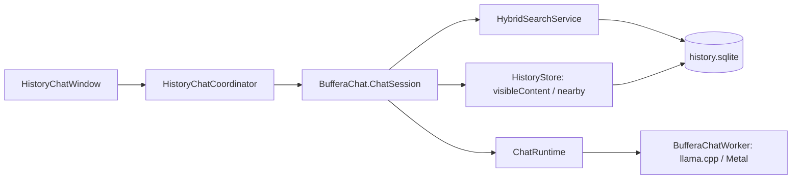

# Ask Buffera

[Documentation](../README.md) · [Русский](../chat.md) · English

Settings → Search and Answers shows the language model's name and size. Download and Enable starts preparation; the feature switch enables a model that is already downloaded. Ask, beside semantic search, opens a local LLM that can search and read clipboard history.

The built-in chat uses the existing history, search, and downloaded Gemma 4 E2B. It introduces no new network services or SQLite migration.

## Responsibilities

- `HistoryChatWindow` displays the conversation, status, and typed source buttons. Generated text is not executed and does not open URLs.
- `HistoryChatCoordinator` connects the window and session, cancels tasks, rejects late events using a generation number, and opens sources through normal history without invoking copying.
- `ChatSession` keeps bounded conversation context in memory, coordinates up to four search/read decisions, and supplies retrieved documents in a separate request to generate the answer.
- `ChatHistoryReader` uses shared Core/Search operations. `HistoryTextContent` is a projection of text, file paths, and cached OCR shared with MCP. External MCP permission does not apply to the built-in chat.
- `ChatRuntime` checks model availability and integrity, manages a private process, and receives a UTF-8 stream over anonymous pipes. The worker uses pinned llama.cpp and the shared library bundle.

## Search and answer evidence

The planner receives the current time, time zone, application names, and bounded observations. It selects `search_history`, `read_clip`, `get_neighbors`, or `finish` in JSON, with validation of allowed keys, types, and ranges. Unknown operations and invented IDs are rejected, and identical calls are not repeated. An invalid plan triggers a bounded search using the question. If a multiword search is empty, up to two attempts with shorter text are allowed while retaining all filters; the actual query is reported to the planner.

After a neighbors request, the session reads a bounded number of neighboring items even if the model repeatedly reads only the anchor. Anchor and neighbor markers accompany the evidence so their content is not conflated. Previous conversation is supplied as reference data within the request; the current question remains a separate field.

Concealed items are always excluded. Reads use `visibleContent`; chat tools cannot obtain concealed content. Results are checked again after asynchronous work; while an answer streams, short read snapshots check that sources still exist and are visible. SQLite snapshots are not held during model computation. Deleting or concealing a source cancels its associated conversation.

A SQLite read error also stops the current answer: no new tokens are displayed until source availability is confirmed. This error reports that history is unavailable but preserves completed messages. A repeated question checks sources again; the conversation is reset only after an item is confirmed to have been deleted or concealed. This check applies before generation, during streaming, and after completion.

The app numbers sources, includes their original copy time, and lists only items that were read. The model is instructed to cite them as `[1]`, `[2]`; actual navigation comes from typed `ChatSource` values, not model text.

## Lifecycle

A conversation lasts until the app quits or New Conversation is selected. Follow-up questions use bounded recent context; previous sources are checked for availability again, and accessing their content requires another read. Conversation history and intermediate tool results are not saved to disk.

Each worker request gets a new KV context; weights are reused. Cancellation, closing the window, disabling or deleting the model, and quitting the app release the process. An additional timer releases it after inactivity. Input and output limits are reported as explicit states: data is not silently truncated.

Gemma template control markers are tokenized separately from message content. User and history text cannot become special template tokens. Content is not included in process arguments or diagnostic messages.

Protocol and conversation-scenario checks use synthetic history. Real Gemma checks use the same `ChatSession` and compiled worker with a separate temporary database.
